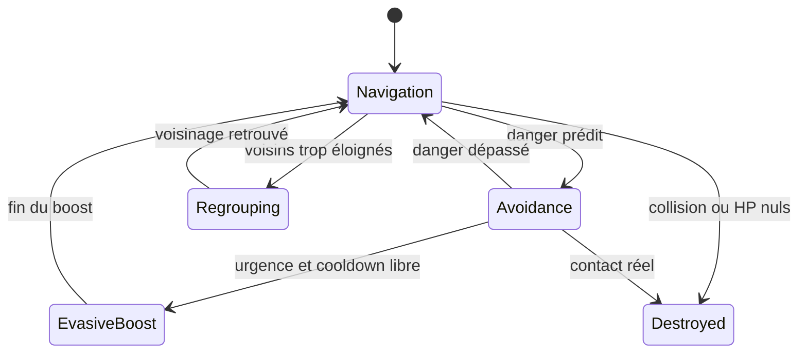
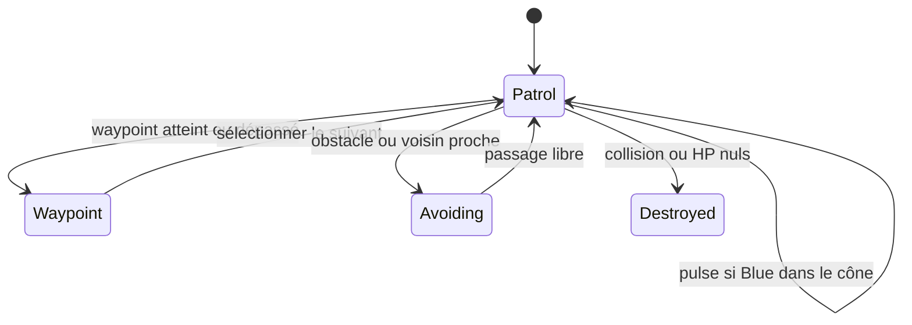
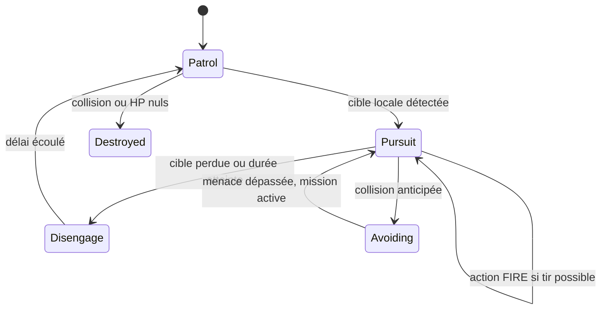
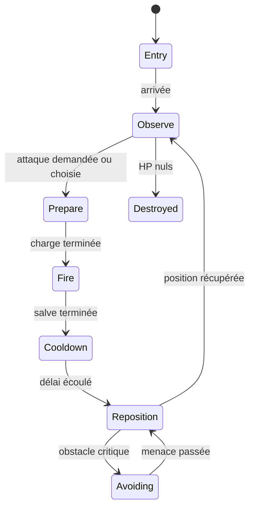
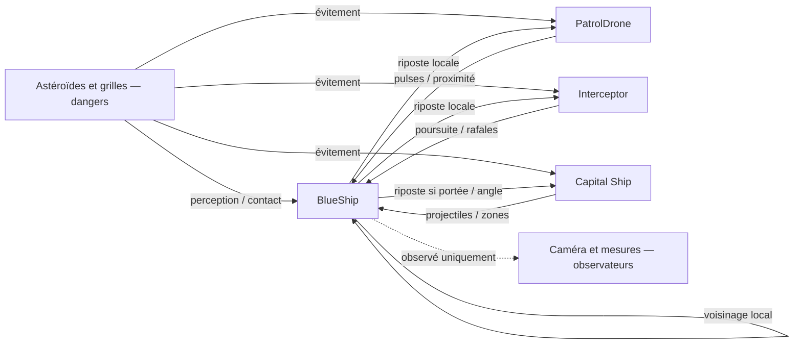

# Rapport final — Simulation SMA spatiale

## 1. Objectif

Observer comment des agents autonomes perçoivent des dangers, adaptent leurs trajectoires et produisent une organisation collective. Le milestone M16 du projet Godot **4.7.2** rassemble la démonstration interactive finale, une étude univariée et des essais de graines ; les performances sont mesurées sur la machine de validation. Aucun PowerPoint n’est généré ; ce document fournit sa matière.

## 2. Environnement

Espace 3D stylisé, déplacement général vers −Z, astéroïdes fixes/mobiles, Mega et Colossal, projectiles et grilles énergétiques. Maillages et décor procéduraux originaux. Les dangers sont peu nombreux mais volumineux : plafonds **64/48/64 rochers** selon phase et **40 unités dangereuses**, beams inclus. Décor, caméra, missiles, grilles et instrument de mesure ne sont pas des agents.

## 3. Les quatre types d’agents

| Agent | Objectif et perceptions | Actions |
|---|---|---|
| BlueShip | Avancer ; voisins locaux, rochers, hostiles et projectiles | Navigation, séparation/cohésion/alignement, évitement, récupération, boost, riposte |
| PatrolDrone | Suivre des waypoints ; rochers et Blue devant son cône | Patrouille, évitement, pulse frontal |
| Interceptor | Détecter une cible locale et conduire une interception temporaire | Patrouille, poursuite, rafale, désengagement, évitement |
| Capital Ship | Observer l’escadron et exécuter un cycle d’artillerie | Préparation, salve, cooldown, repositionnement, évitement |

## 4. Perceptions et actions

Les BlueShip filtrent les voisins par distance : 32 m en FREE, 48 m dans le profil Guided ; récupération locale jusqu’à 50/100 m. Les grands rochers augmentent l’anticipation jusqu’à 150–250 m. Les vitesses relatives servent à estimer le passage le plus proche. Pour une grille, l’agent projette le plan et les ouvertures en tenant compte de la rotation, puis mémorise son choix. Les pertes proviennent de collisions ou de dégâts réels.

Les Patrol cherchent un waypoint puis une cible dans leur cône frontal. Les Interceptor utilisent distance, cible valide, cône/ligne de tir et durée de poursuite. Le Capital observe centre/vitesse du groupe pour ses attaques externes ; les tirs partis ne commandent pas les BlueShip.

## 5. Machines à états

Le comportement Blue combine plusieurs forces ; le diagramme décrit l’état dominant affiché. Le combat possède aussi un état parallèle de cible/cooldown.

FIRE est une **action de rafale** de l’Interceptor, pas un cinquième état de sa machine de mission. L’évitement peut temporairement dominer la mission.

Le séquenceur Guided espace les demandes d’attaques ; il peut les déclencher pendant l’entrée/repositionnement. Les transitions observées sont rapportées, plutôt que supposées toutes identiques au schéma.

## 6. Interactions

## 7. Règles BlueShip et absence de leader

Séparation évite les voisins trop proches ; cohésion rapproche du voisinage local ; alignement rapproche les vitesses ; recovery permet un retour local après un détour. Le steering est borné puis la vitesse évolue progressivement. L’évitement peut prendre la priorité et le boost reste un secours temporaire.

**Aucun leader ni destination globale normale** ne guide les BlueShip. Le centre global sert à la caméra, aux statistiques, à la génération des dangers, aux positions d’arrivée et à l’artillerie externe. Chaque agent choisit sa propre ouverture ; des sous-groupes peuvent persister.

## 8. Démonstration guidée et présentation

Interface historique M16, conservée ici pour documenter les essais ci-dessous : GUIDED automatique et FREE dans le panneau. La version utilisateur actuelle ouvre READY de Presentation ; ses commandes sont décrites dans « Démonstration soutenance ». **F1–F6** et les boutons **P1–P6** ouvrent directement Obstacles, Astéroïdes dynamiques, Patrol, Interceptor, Capital et Finale. Un saut nettoie uniquement Guided, recrée quinze Blue et la phase demandée, remet le timer à zéro et recentre la caméra. Les nettoyages ne sont pas des morts ; les pertes cumulées restent conservées.

**P / Pause** suspend agents, projectiles, caméra et timer. Le label PAUSE et les contrôles restent actifs. Un saut pendant pause reste en pause ; quitter Guided ou Replay reprend la simulation. **TAB/H** basculent réglages/aide, initialement masqués. Le HUD permanent se limite aux pertes bleues, étoiles et titre de phase ; PAUSE est temporaire.

Phases 1–4 : 18 s réelles ; phase Capital : 42 s, un cycle Heavy → Seeker → Gate → Bomb → Grid → Swarm → Arc. Finale : continue, cible 15 Blue / 4 Patrol / 4 Interceptor / 3 Capital, remplacements réels. Les contrôles, sauts, reprise, Replay et résolutions ont leurs validations dédiées.

| Attaque | Signature visible et réaction locale |
|---|---|
| Heavy | Projectile volumineux ; anticipation du passage et éventuel boost |
| Seeker | Missile à guidage limité ; esquive selon vitesse relative |
| Moving Laser Gate | Plan mobile à ouvertures ; choix et mémoire d’un passage |
| Bomb | Explosion/zone retardée ; sortie du volume menaçant |
| Rotating Grid | Grille mobile tournante ; projection des ouvertures à la traversée |
| Swarm | Plusieurs missiles décalés ; priorités entre menaces et boost |
| Arc | Salve balistique courbe ; réaction si la trajectoire menace réellement un Blue |

## 9. Protocole expérimental et paramètres

Vingt essais **univariés**, seed 20261012, **60,00 s simulées** chacun (environ 30 s du timer Guided à 2×). Exécution headless accélérée : ce timer ne mesure pas la durée murale du programme. Quatre valeurs par paramètre ; tous les autres restent nominaux. Un seul essai par valeur : les tendances ne constituent pas des conclusions statistiques générales.

Le scénario contrôlé emploie les quatre types d’agents en finale et un lot nominal de **32 rochers**. Sa densité est `round(32 × coefficient)`, plafonnée à 62 pour réserver des places aux grands événements. Les dangers/règles sont ceux de M15 ; le parcours normal conserve son lot nominal de 62. Les multiplicateurs nominaux d’étude valent 1,0 ; le profil de présentation conserve ses réglages Guided. La fixture reste figée deux frames à l’initialisation, puis pilote le séquenceur au pas physique et s’arrête à 60 s simulées. Le parcours de présentation normal garde son timer au rendu. Cette séparation évite un décalage de première frame entre un essai isolé et une suite. Les répétitions nominales dans les cinq séries et le test à froid/après un essai donnent les mêmes mesures avec ce pas fixe.

L’espacement est la moyenne temporelle des distances au **voisin le plus proche**. La dispersion est le rayon maximal autour du barycentre, pas une variance statistique. L’excursion X/Y est celle du centre collectif, mesurée comme sa distance à l’axe Z du scénario. Un isolé n’a aucun voisin dans sa portée locale. Les réactions sont des événements/échantillons d’évitement, pas des collisions certainement évitées. Les contacts mortels distinguent rochers/hostiles des dégâts de projectiles/zones. Les transitions et compteurs sont observés par une instrumentation externe sans force de navigation.

| Paramètre | Faible | Nominale | Élevée | Effet observé |
|---|---:|---:|---:|---|
| Spacing | 0,8 | 1,0 | 1,4 | Espacement croissant sur cette graine ; pertes différentes selon le coefficient |
| Movement | 0,7 | 1,0 | 1,6 | Détours/pertes différents ; augmenter ne garantit pas davantage de sécurité |
| Rock density | 0,7 | 1,0 | 2,0 | Davantage de rochers et de réactions ; pertes non monotones |
| Fire intensity | 0,7 | 1,0 | 2,0 | Plus de tirs à 1,5/2,0 ; boosts et pertes non monotones |
| Interceptor count | 0 | 4 | 6 | Poursuites croissantes ; rafales/boosts limités aussi par géométrie et budgets |

## 10. Résultats expérimentaux

### Séparation

| Coefficient | Espacement moyen (m) | Dispersion max → fin (m) | Contacts mortels | Morts / renforts | Échantillons récupération |
|---|---|---|---|---|---|
| 0.8 | 16,68 | 129,27 → 73,60 | 1 | 3 / 3 | 634 |
| 1.0 | 17,21 | 104,52 → 56,68 | 3 | 3 / 3 | 953 |
| 1.2 | 18,57 | 113,17 → 82,86 | 0 | 0 / 0 | 655 |
| 1.4 | 19,96 | 115,99 → 60,19 | 0 | 0 / 0 | 777 |

L’espacement moyen croît ici avec le coefficient, mais celui-ci ne fixe pas une distance exacte. Les coefficients 0,8 et 1,0 produisent chacun trois pertes ; 1,2 et 1,4 n’en produisent aucune sur cette graine. Ce résultat ne garantit pas la même hiérarchie ailleurs.

### Mouvement

| Coefficient | Excursion du centre X/Y (m) | Dispersion max → fin (m) | Boosts | Morts |
|---|---|---|---|---|
| 0.7 | 22,01 | 128,10 → 48,47 | 33 | 0 |
| 1.0 | 56,24 | 104,52 → 56,68 | 26 | 3 |
| 1.3 | 27,05 | 141,02 → 48,69 | 43 | 5 |
| 1.6 | 32,98 | 133,59 → 97,80 | 42 | 2 |

L’excursion collective n’est pas monotone. Le réglage change les interactions avec les menaces, pas seulement l’amplitude d’un mouvement libre. Dans cette graine, 0,7 ne produit aucune perte, 1,0 en produit trois, 1,3 cinq et 1,6 deux ; le classement dépend des rencontres avec les dangers.

### Densité des rochers

| Coefficient | Rochers max | Réactions aux rochers | Contacts mortels | Morts | Dispersion finale (m) |
|---|---|---|---|---|---|
| 0.7 | 23 | 72 | 1 | 1 | 61,76 |
| 1.0 | 33 | 106 | 3 | 3 | 56,68 |
| 1.5 | 49 | 117 | 0 | 1 | 67,13 |
| 2.0 | 63 | 131 | 1 | 1 | 72,42 |

Le nombre de réactions augmente globalement avec le lot de rochers. Les pertes ne croissent pas régulièrement : trajectoires, renforts et attaques se combinent. Les grands événements s’ajoutent au lot contrôlé sous le plafond de 64.

### Intensité des tirs

| Coefficient | Tirs ciblés | Boosts | Impacts | Morts / renforts |
|---|---|---|---|---|
| 0.7 | 65 | 32 | 3 | 2 / 2 |
| 1.0 | 59 | 26 | 0 | 3 / 3 |
| 1.5 | 132 | 49 | 2 | 1 / 1 |
| 2.0 | 138 | 40 | 2 | 2 / 2 |

Davantage de tirs ciblés ne signifie pas proportionnellement davantage de morts. Les cônes, cooldowns, trajectoires et plafonds filtrent les départs. Le calendrier des attaques Capital reste espacé dans Guided.

### Nombre d’Interceptor

| Nombre | Poursuites commencées | Rafales commencées | Boosts Blue | Morts |
|---|---|---|---|---|
| 0 | 0 | 0 | 23 | 4 |
| 2 | 10 | 16 | 41 | 0 |
| 4 | 24 | 11 | 26 | 3 |
| 6 | 30 | 25 | 48 | 0 |

Les poursuites passent de 0 à 30, mais les rafales ne suivent pas une progression régulière. Même sans Interceptor, Patrol, Capitals et dangers provoquent des boosts et pertes.

## 11. Exemple mesuré de phénomène émergent

Fixture Gate, quinze Blue sans trajectoire collective imposée : **dispersion avant 26,83 m → maximum 52,80 m → 25,81 m après 15 s simulées de récupération**, zéro perte et zéro isolé final. La dispersion est presque doublée, puis revient à l’échelle initiale grâce aux règles locales.

Danger externe → choix locaux d’ouvertures différents → dispersion → grille dépassée → cohésion/alignement/recovery → récupération. Ce cas clair ne garantit pas le regroupement complet dans toutes les scènes ; la finale peut conserver une dispersion importante.

## 12. Robustesse aux conditions initiales

Même finale contrôlée et paramètres nominaux, cinq seeds, même durée simulée :

| Seed | Morts / renforts | Boosts | Dispersion max (m) | Dispersion finale (m) | Isolés finaux | Blue actifs |
|---|---|---|---|---|---|---|
| 20261012 | 3 / 3 | 26 | 104,52 | 56,68 | 0 | 15 |
| 20261013 | 2 / 2 | 46 | 96,92 | 59,07 | 0 | 15 |
| 20261014 | 3 / 3 | 49 | 112,77 | 64,05 | 0 | 15 |
| 20261015 | 2 / 2 | 55 | 96,64 | 60,86 | 0 | 15 |
| 20261016 | 1 / 1 | 58 | 137,14 | 60,84 | 0 | 15 |

Les pertes varient de 1 à 3, les boosts de 26 à 58 et la dispersion finale de 56,68 à 64,05 m. Chaque essai termine avec quinze Blue actifs ; les renforts compensent les pertes avec un délai. Ce maintien ne signifie pas absence de danger. Zéro isolé local ne prouve pas un unique groupe compact : plusieurs sous-groupes voisins peuvent rester éloignés. Cinq seeds et une fenêtre courte ne suffisent pas à établir une robustesse parfaite.

## 13. Terminaison et validation finale

FREE est potentiellement continu. GUIDED termine les phases 1–5 selon leurs timers ; la phase 6 continue jusqu’à quitter/rejouer. Les Blue détruits sont remplacés ; les pertes restent cumulées jusqu’à Replay/nouveau run. Les fixtures historiques peuvent réactiver le Game Over ancien.

Godot 4.7.2, Intel Arc Graphics, OpenGL Compatibility/MSAA 4×, fenêtre et rendu **1920×1080**, vitesse **2×**, physique moteur **120 Hz**. Benchmark sans PNG : **94,22 FPS moyens**, minimum sur une seconde **63,63 FPS**. Phases 1–5 suivies de **60,00 s réelles de finale**. Deux secondes initiales de création/chauffe sont exclues des FPS ; les métriques physiques couvrent toute la phase 1. Les captures/UI sont vérifiées séparément.

**Objectif performance atteint sur cette mesure : moyenne >80 FPS et minimum 1 s >60.** Les animations des réacteurs/aura/charge sont mises à jour au rendu, sans modifier les décisions, la visée ou les collisions à 120 Hz. Le MSAA reste à 4×. Les lumières de flash sont masquées seulement lorsque leur énergie est nulle ; l’impact visible est conservé.

| Phase | Blue actifs | Pertes de phase / cumulées | Renforts de phase | Boosts | Rochers max | Nœuds max | Dangers max / projectiles physiques max |
|---|---|---|---|---|---|---|---|
| 1 | 15 | 0 / 0 | 0 | 1 | 63 | 1318 | 0 / 0 |
| 2 | 15 | 0 / 0 | 0 | 1 | 47 | 1563 | 0 / 0 |
| 3 | 15 | 0 / 0 | 0 | 17 | 3 | 1328 | 4 / 4 |
| 4 | 15 | 1 / 1 | 1 | 18 | 3 | 1130 | 16 / 16 |
| 5 | 15 | 0 / 1 | 0 | 22 | 0 | 1200 | 18 / 14 |
| 6 | 15 | 4 / 5 | 4 | 87 | 63 | 1813 | 26 / 25 |

Finale : **15 Blue / 4 Patrol / 4 Interceptor / 3 Capital**, 5 pertes cumulées sur le parcours, 5 renforts cumulés, 202 tirs ciblés et 8 impacts pendant la finale. 5 Mega et 2 Colossal émis ; 1 Gate et 2 Grid, avec 10 passages intérieurs / 34 contournements. Une grande grille et un Colossal au plus simultanément.

| Phase | FPS moyens des fenêtres 1 s | Minimum 1 s |
|---|---|---|
| 1 | 98,68 | 96,48 |
| 2 | 99,51 | 94,77 |
| 3 | 99,73 | 98,12 |
| 4 | 99,88 | 98,99 |
| 5 | 99,63 | 98,88 |
| 6 | 84,47 | 63,63 |

| Phase | Dispersion max → fin (m) | Centre X/Y max depuis début de phase (m) | Réactions rochers |
|---|---|---|---|
| 1 | 110,05 → 85,52 | 33,75 | 111 |
| 2 | 84,88 → 63,54 | 29,92 | 74 |
| 3 | 63,73 → 34,73 | 15,68 | 0 |
| 4 | 50,50 → 36,23 | 15,25 | 0 |
| 5 | 98,50 → 66,22 | 35,24 | 0 |
| 6 | 159,98 → 99,67 | 36,64 | 155 |

Phase 5, tirs et réactions par famille (Laser réunit Gate/Grid) :

| Famille | Tirs/activations | Réactions | Impacts |
|---|---|---|---|
| Heavy | 3 | 27 | 0 |
| Seeker | 6 | 12 | 0 |
| Laser | 2 | 30 | 0 |
| Bomb | 2 | 15 | 0 |
| Swarm | 10 | 18 | 0 |
| Arc | 4 | 4 | 0 |

Arc peut manquer le groupe : zéro réaction sur ce passage natif de phase 5 ; sa réaction est validée dans une fixture ciblée M15.

Phase 2 : 45 DIAGONAL, 39 VERTICAL, 41 CIRCULAR, 40 ARC; Mega et Colossal présents dans les deux premières phases.

Phase 3 : 60 choix de waypoint, 12 routes A–B–C–D achevées et 22 pulses. Phase 4 : 11 poursuites, 18 rafales et 11 désengagements cumulés, remplacements inclus.

| Phase | Transition réellement observée | Nombre |
|---|---|---|
| 4 | Interceptor:DISENGAGE→PATROL | 7 |
| 4 | Interceptor:PATROL→PURSUIT | 7 |
| 4 | Interceptor:PURSUIT→DISENGAGE | 11 |
| 5 | Capital:COOLDOWN→REPOSITION | 7 |
| 5 | Capital:ENTRY→OBSERVE | 3 |
| 5 | Capital:FIRE→COOLDOWN | 7 |
| 5 | Capital:OBSERVE→PREPARE | 7 |
| 5 | Capital:PREPARE→FIRE | 7 |
| 5 | Capital:REPOSITION→OBSERVE | 7 |

Les treize suites M1–M16 contrôlent les régressions, les interfaces et la simulation. La validation M16 vérifie notamment agents/projectiles/timer/caméra figés, reprise, F5 puis F3 sans résidus, F6 à 15/4/4/3, nettoyage sans mort et Replay à seed/phase/pertes initiales. Rendu 1280×720, 1920×1080, maximisé Windows et fullscreen contrôlés séparément ; captures dans `.godot/validation`, non versionnées.

## 14. Réalisme et limites

Le modèle est **stylisé/arcade**, sans physique orbitale réaliste. Perception locale, anticipation, inertie simplifiée, collision et réaction aux menaces restent cohérentes comme idées de simulation. Paramètres réglés empiriquement, prédictions approximatives, collisions simplifiées et trajectoires parfois mises en scène pour l’oral. La caméra et le séquenceur ne sont pas des agents. Recovery locale ne garantit pas une réunion complète ; la seed et la cadence peuvent modifier les pertes. Les captures perturbent la cadence et restent exclues des FPS. La finale dépasse 60 FPS dans ce benchmark ; cela ne garantit pas ce débit sur toute machine ou au plein écran physique 3840×2400. Le plein écran 3840×2400 coûte davantage que la fenêtre 1080p, même avec un rendu interne 1080p. Ces chiffres ne garantissent pas les performances d’un autre poste.

## 15. Avantages

Règles locales simples, comportement collectif visible, absence de leader, quatre rôles distincts, dangers extensibles sans nouveau type d’agent, démonstration interactive et expériences reproductibles avec seed/pas/configuration explicites. Le rapport relie les observations à des mesures plutôt qu’à une garantie de survie.

## 16. Améliorations futures

Apprentissage/adaptation, coopération explicite, communication inter-agent, navigation 3D plus avancée, formations dynamiques, physique plus réaliste et simulation distribuée. Ces pistes sont proposées, **sans implémentation dans M16**.

## 17. Conclusion et historique

Le projet démontre un système multi-agents spatial à quatre types : les interactions locales produisent détours, dispersion, esquives et récupération. L’étude montre des compromis et une sensibilité aux conditions initiales, sans optimisation universelle. La présentation peut alterner phases, pause et exemples mesurés.

M1–M3 ont établi le vol collectif ; M4–M6 les quatre agents et le combat ; M7–M11 les contrôles/démo ; M12–M15 la lisibilité, l’anticipation, les renforts et les dangers arcade. L’[historique détaillé](docs/HISTORIQUE_M1_M15.md) conserve les anciennes validations. Les [données brutes](docs/experiments/m16_results.json) et scripts permettent de refaire l’étude. Le PowerPoint reste à préparer à partir de ce rapport.

## Démonstration soutenance

La présentation utilise les agents et armes existants, avec une horloge propre. Chaque phase dure **30 s**, avec quatre transitions de **0,5 s** : **152 s (~2 min 32)** automatiques, puis un laboratoire final interactif sans limite de durée. Les durées et mesures scientifiques GUIDED M16 restent celles présentées ci-dessus.

| Phase | Durée | Population ennemie visée, pour 15 BlueShip |
|---|---:|---|
| 1 | 30 s | Aucun ennemi : évitement collectif |
| 2 | 30 s | 15 PatrolDrone |
| 3 | 30 s | 15 Interceptor |
| 4 | 30 s | 6 Capital Ships |
| 5 | 30 s, puis sandbox | 15 Patrol + 15 Interceptor + 6 Capital, soit 36 ennemis |

Les BlueShip combattent en P2–P5 lorsque portée, cône et ligne de vue le permettent ; la sécurité reste prioritaire et leur navigation ne poursuit pas les ennemis. Des fenêtres de Capital à 70–76 m pendant 5–6 s rendent le blindage arrière accessible à la portée Blue existante. Les ennemis disparus sont remplacés après 0,8–1,4 s réelles pour les unités légères et 2–4 s pour les Capital, avec un RNG déterministe. Le HUD affiche cumulativement « Vaisseaux bleus détruits » et « Ennemis abattus ». Seules les destructions de combat augmentent le second compteur ; les retraits, skips et nettoyages ne comptent pas. R recommence avec les deux compteurs à zéro.

Le panneau **LABORATOIRE DE BATAILLE**, distinct de FREE et ancré à gauche, apparaît dès P5. Il affiche les quatre compteurs actifs/détruits et onze réglages : Patrol 0–30, Interceptor 0–30, Capital 0–10, cadence 0,5–4×, largeur projectiles 0,5–3×, épaisseur grilles 0,5–3×, vitesse 0,5–2×, dégâts 1–3, densité 0–2,5×, Mega/Colossal 0–3 et agressivité 0,5–3×. Les volumes physiques et perçus suivent les largeurs. BlueLaser utilise désormais une sphère balayée de rayon 0,7 m, un corps cyan de 0,48 m (ancien : 0,24 m) et une pointe de rayon 0,52 m. Le masque reste rochers + hostiles, sans Blue. Les bases Presentation sont multipliées par 1,75 pour les tirs Interceptor et 1,5 pour les pulses Patrol, avant le slider. Les cibles supplémentaires arrivent progressivement, et les réductions sont administratives.

RESET rétablit 15/15/6 ennemis, cadence 2×, largeurs/vitesse/densité/agressivité 1×, dégâts légers 1 et Mega normal, sans effacer les pertes/kills. CHAOS utilise 25/25/8 ennemis, cadence 3×, largeur 1,7×, grilles 1,8×, vitesse 1,3×, dégâts 2, densité 1,6×, Mega élevé et agressivité 2×. ESPACE ou TERMINER fige FIN ; R recommence et D/Échap restaure FREE.

La Presentation est la démonstration principale dès Play : READY affiche DÉMARRER et **ALLER À LA FINALE**. Ce second bouton reste visible en P1–P4 ; F8 offre le même saut et F7 prépare/recommence. Le saut nettoie les hazards et ennemis précédents sans score, conserve les compteurs réels déjà obtenus et démarre P5 à t=0, avec Battle Lab immédiatement visible. GuidedDemonstration reste un helper interne, testé mais retiré de l'interface utilisateur.

Les spawns finaux Patrol et Interceptor sont bornés autour du centre Blue : X ±20–55/60 m, Y ±25 m, Z −80…−35 m, avec recherche alternative sûre dans X ±58 / Y ±32 / Z −85…−35 m. Les Patrol suivent des boucles de waypoints, sans poursuite. Une ancre 3D mobile se recale progressivement après un déplacement de plus de 18 m du centre. Le cône frontal nominal vaut 43° et la portée 70 m. Les Interceptor privilégient les Blue dans les 100 m du centre, répartissent leurs cibles selon proximité, ligne de vue et charge, puis se désengagent vers une position locale à environ 45 m. Après 3 s hors zone (>115 m Patrol, >145 m Interceptor non engagé), un recyclage hors champ est administratif, sans kill ni mort. Les Capital conservent leur rôle lointain et les raids temporaires.

Un scheduler indépendant des cycles Capital déclenche les Gate/Grid toutes les 1,667 s au réglage nominal : objectif 18 lancements réels par phase, trois fois les six du main au départ de ce correctif. La fréquence répond au slider, l'épaisseur agit sur les nouvelles grilles. Les sept formes et leurs ouvertures sont conservées, sans répétition consécutive ; timing, positions et rotations diffèrent. Une grille passée derrière toute la flotte est nettoyée immédiatement. La troisième/quatrième grille ne sont autorisées qu’à partir de 75 FPS mesurés ; le plafond est quatre grandes grilles et 48 unités dangereuses, beams compris. Des quotas distincts évitent que les pulses verts monopolisent toutes les occasions de tir. Les tests mesurent les lancements, traversées, contournements, distances, engagements et performances en 1080p. Ces essais de Presentation ne remplacent aucune mesure scientifique M16.

1. « Les BlueShip se dispersent et se regroupent par des règles locales, sans leader. »
2. « Chaque Patrol garde sa propre route, et un adversaire abattu est remplacé. »
3. « L'Interceptor sélectionne localement une cible, poursuit, tire et se désengage. »
4. « La flotte capitale alterne les attaques et les formes de grilles ; ses fenêtres de proximité permettent la riposte. »
5. « Le laboratoire montre immédiatement les effets de la cadence, des volumes et des populations sur la bataille. »

La Presentation utilise des meshes/matériaux partagés pour les tirs et explosions, un rejet de plan avant les contacts des grilles, des perceptions de proximité espacées de 0,06–0,08 s simulée, un pas physique de 90 Hz (0,0222 s simulée à 2×) et MSAA 2×. Les sweeps de projectiles et les collisions de déplacement restent actifs. Les réglages du viewport et de simulation libre sont restaurés à la sortie. Les comptes rendus 1080p précisent ces conditions.

### Mesures du correctif de finale

Passage natif du 15/10/2026, seed 20261012, rendu et fenêtre **1920×1080**, Intel Arc, MSAA 2×, physique 90 Hz. Chaque fenêtre P4/P5/CHAOS dure 30 s réelles ; aucune destruction n’est injectée dans ces mesures. Les traversées sont des événements agent/grille.

| Fenêtre | FPS moyen / min 1 s | Gate + Grid lancées | Traversées / contournements | Grilles simultanées max | Nodes max | Projectiles hostiles max | Combat hazards max | Unités dangereuses max |
|---|---:|---|---:|---:|---:|---:|---:|---:|
| P4 | 99,98 / 99,84 | 9 + 9 | 151 / 100 | 2 | 1594 | 11 | 4 | 23 |
| P5 | 99,76 / 96,45 | 9 + 9 | 145 / 106 | 2 | 2341 | 28 | 2 | 38 |
| CHAOS | 97,88 / 85,25 | scheduler continu | 216 / 62 | 2 | 2911 | 29 | 2 | 41 |

P4 et P5 ont chacune lancé **18 nouvelles grandes grilles**, contre six dans le main de départ. Les sept géométries sont observées dans chaque phase. Le maximum sur tout le parcours, sliders inclus : **29 projectiles hostiles**, **2911 nodes**, **4 combat hazards**, **41/48 unités dangereuses** beams compris. Les phases et CHAOS restent au-dessus de 60 FPS au minimum sur une seconde dans ce passage.

| Distance en P5 | Moyenne | Médiane | Maximum | Mesures sous 100 m | Temps avec ≥80 % sous 100 m |
|---|---:|---:|---:|---:|---:|
| Patrol | 41,51 m | 41,82 m | 89,35 m | 100,00 % | 100,00 % |
| Interceptor | 52,80 m | 49,70 m | 135,95 m | 98,52 % | 100,00 % |

Les **15/15 Patrol initiaux** ont tiré ; les **15/15 Interceptor initiaux** ont poursuivi, les **15/15** ont tiré et les **15/15** se sont désengagés. Ces comptes distinguent les unités initiales de leurs remplaçants.

Sliders 15→25, dix unités ajoutées progressivement ; distances à leur apparition :

| Nouveaux slots 15…24 | Distances au centre, en mètres |
|---|---|
| Patrol | 88,64, 64,04, 65,68, 54,62, 65,97, 80,82, 81,50, 65,61, 83,87, 77,88 |
| Interceptor | 72,89, 68,93, 76,52, 66,18, 47,98, 79,45, 78,90, 88,70, 95,79, 57,34 |

Les dix Interceptor ajoutés ont acquis une cible dès leur premier échantillon ; première rafale après **0,21–1,36 s**, avant 4 s. La distance maximale d’apparition des vingt ajouts vaut **95,79 m** dans ces fenêtres. Le désengagement rejoint la mission locale ; en CHAOS, **99,27 %** des mesures Interceptor sont sous 100 m.

Fixtures séparées : ancien rayon central qui rate / nouvelle sphère Blue qui touche à 1 m de décalage sur une cible de rayon 0,5 m ; décalage 1,4 m qui rate ; tir à 3000 m/s sans tunneling ; rocher bloquant et Blue intercalé intact. Les bases rouge/verte et les multiplicateurs physique/visuel/perçu sont vérifiés. Recyclage hors champ et nettoyages : zéro kill et zéro respawn de mort. Le clic UI vérifie 15/15/6 à l’entrée ; les Mega/Colossal vérifient aussi les hostiles avant leur apparition.
