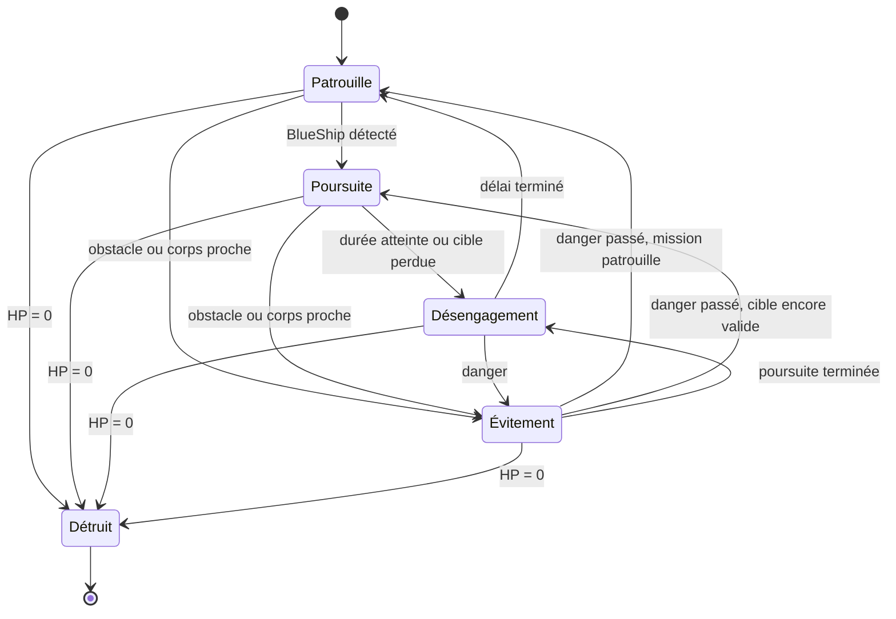
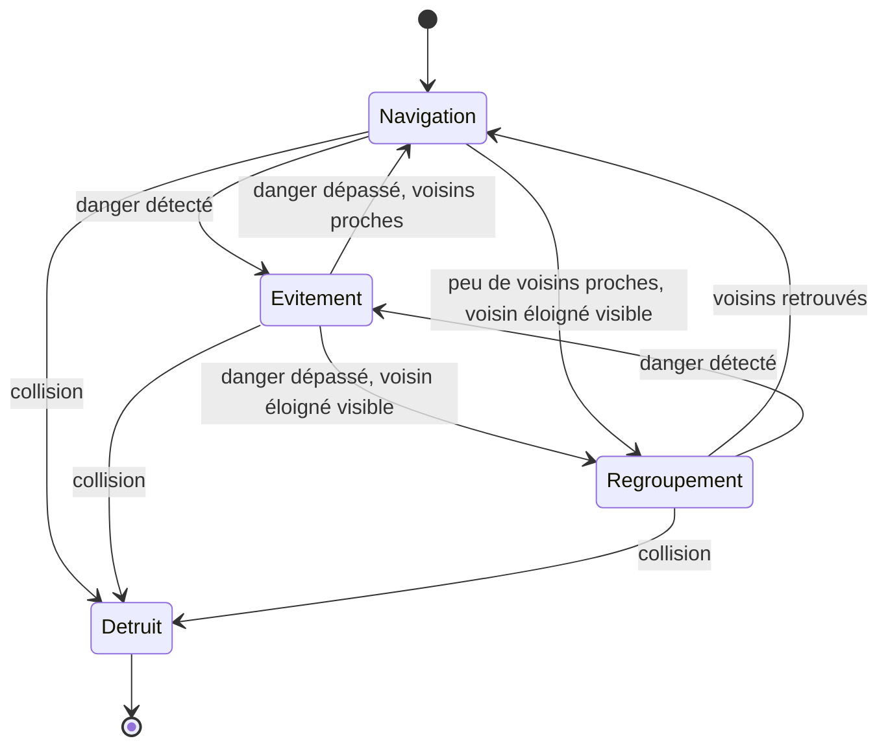
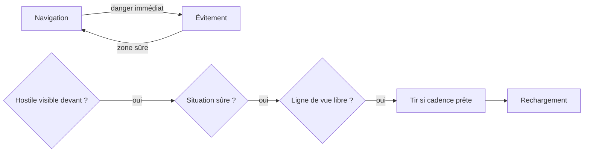
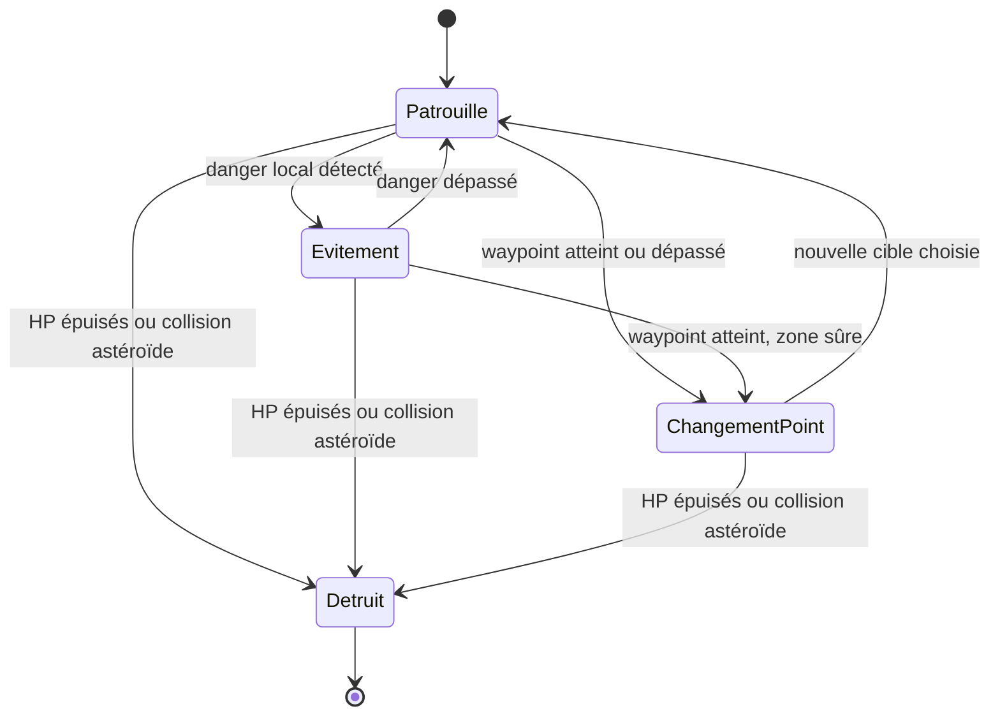
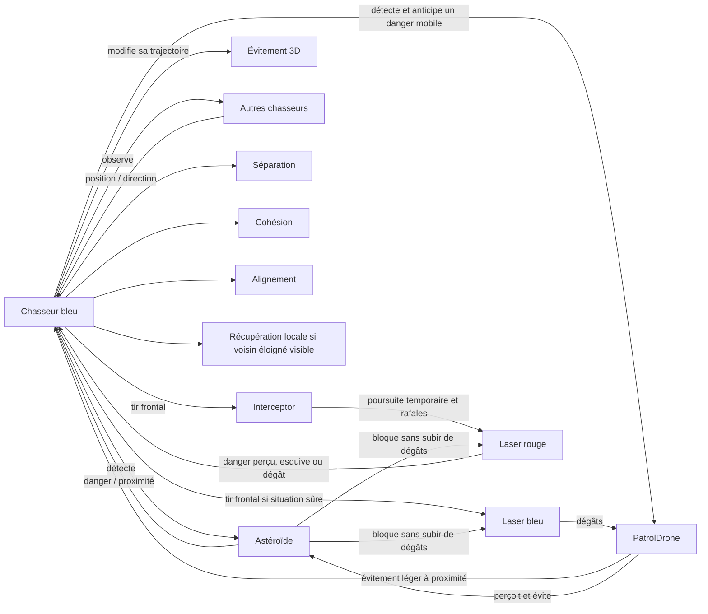

# Rapport — Simulation multi-agents spatiale sous Godot

## 1. Objectif du projet

Le projet consiste à réaliser sous **Godot 4.7.2** une simulation 3D de systèmes multi-agents dans un environnement spatial.

L'objectif est d'observer comment plusieurs agents autonomes se déplacent, perçoivent leur environnement, évitent des dangers et réagissent à d'autres agents. Le projet est développé progressivement afin de conserver un modèle simple, compréhensible et facile à présenter.

À terme, la simulation devra comporter au moins **4 types d'agents** et mettre en évidence au moins **un phénomène émergent**.

---

## 2. État actuel du projet

### Milestone 1 — Fondation

Le premier milestone a mis en place :

- 10 chasseurs bleus autonomes ;
- des astéroïdes de plusieurs tailles ;
- un environnement spatial 3D ;
- un mouvement autonome sur X, Y et Z ;
- séparation, cohésion et alignement entre chasseurs ;
- détection et évitement des obstacles ;
- collision réelle avec destruction du chasseur ;
- compteur de vaisseaux vivants et de morts.

### Milestone 2 — Mouvement, espacement, graphismes et caméra

Le deuxième milestone a amélioré :

- le mouvement relatif avant/arrière des chasseurs ;
- l'espacement entre les chasseurs ;
- l'anticipation des obstacles ;
- la prise en compte de plusieurs menaces proches ;
- les hitboxes ;
- le modèle visuel des chasseurs ;
- la variété et la rotation des astéroïdes ;
- le décor spatial ;
- une caméra de suivi et une caméra libre orbitale.

Validation historique du M2 avec la seed `20261012` :

- **10 survivants sur 10 après 90 secondes** ;
- distance moyenne au voisin le plus proche : **11,41 m** ;
- rapprochement minimal ponctuel : **5,52 m**.

Ce résultat historique conserve la possibilité d'une collision réelle dans une situation difficile ; il ne garantit pas la survie des versions suivantes.

### Milestone 3 — Regroupement et champ continu

Le troisième milestone ajoute :

- un regroupement autonome sans leader ni place attribuée ;
- une récupération locale jusqu'à **50 m**, lorsqu'un chasseur a peu de voisins proches ;
- un champ d'astéroïdes renouvelé devant les chasseurs et nettoyé derrière tous les survivants ;
- six configurations : rocher isolé, paire décalée, paire horizontale, paire verticale, groupe décalé, gros rocher avec deux petits compagnons ;
- trois difficultés automatiques selon la distance : facile avant **500 m**, intermédiaire jusqu'à **1 100 m**, difficile ensuite ;
- l'affichage de la distance, de la difficulté, de l'espacement moyen et de la dispersion, actualisé toutes les **0,4 seconde**.

Les astéroïdes sont des **obstacles de l'environnement et non des agents**. À la fin de M3, BlueShip était le seul type d'agent implémenté. Les graphismes et les commandes de caméra du M2 sont conservés.

Validation M3 sous Godot 4.7.2, seed `20261012`, pas fixe de 1/60 seconde, sans warning ni erreur :

| Résultat | 90 secondes | 300 secondes |
|---|---:|---:|
| Survivants / morts | 10 / 0 | 10 / 0 |
| Distance parcourue | 949,02 m | 3 167,86 m |
| Difficulté finale | 2 | 3 |
| Astéroïdes actifs au maximum | 29 | 40 |
| Configurations créées / supprimées | 27 / 16 | 92 / 79 |

Sur les 90 premières secondes, la distance moyenne au voisin le plus proche vaut **11,04 m**, le rapprochement minimal **6,71 m** et la dispersion maximale **23,96 m**. Aucun chasseur isolé au-delà du rayon normal de 32 m n'est observé. Les agents continuent d'avancer et le champ se renouvelle.

Après cinq minutes, il reste **29 astéroïdes actifs**, sous le plafond de **72**. Le nombre total de nœuds atteint au plus **620**. Le temps moyen de calcul par tick en mode headless reste proche de **0,48 ms** dans les deux fenêtres mesurées en difficulté 3. Cette mesure ne représente pas les FPS du rendu.

Les tests vérifient également les six configurations, leur reproduction avec la même graine, les seuils de difficulté, le nettoyage derrière un retardataire et l'absence de références invalides après suppression. Les tests de collisions réelles, de caméra et de mouvement du M2 restent valides.

---

### Milestone 4 — Drone de patrouille et difficulté au clavier

M4 ajoute le deuxième véritable agent, **PatrolDrone**, avec **deux drones verts** qui suivent leur propre route. Ils perçoivent leur waypoint, les astéroïdes locaux et les chasseurs très proches. Leurs décisions changent leur trajectoire ; ils ne poursuivent pas les BlueShip.

Les chasseurs anticipent désormais les croisements avec les drones à partir de leurs vitesses relatives. Les drones effectuent aussi un évitement léger à proximité d'un chasseur. Un contact réel reste possible : le BlueShip peut être détruit, tandis que le drone est considéré plus robuste. Un drone qui touche un astéroïde explose et Main le remplace après quelques secondes.

Les touches **0 / 1 / 2 / 3** permettent de reprendre le mode automatique ou de choisir facile, intermédiaire et difficile. Le changement concerne les nouvelles configurations d'astéroïdes ; celles déjà présentes restent en place. Le HUD indique **AUTO / MANUEL** et le nombre de drones actifs. Les statistiques et la caméra continuent à observer uniquement le groupe bleu.

Validation M4 sous Godot 4.7.2, seed `20261012`, pas fixe de 1/60 seconde, sans warning ni erreur :

| Résultat, 90 secondes | AUTO | MANUEL difficile dès le départ |
|---|---:|---:|
| BlueShip vivants / morts | 10 / 0 | 10 / 0 |
| Drones actifs / détruits | 2 / 0 | 2 / 0 |
| Distance parcourue | 948,98 m | 947,74 m |
| Difficulté finale | 2 | 3 |
| Astéroïdes actifs maximum | 29 | 38 |
| Ticks-agent de réaction à un drone | 432 | 231 |

Un tick-agent est un pas de simulation où un chasseur anticipe un danger mobile. Ce chiffre n'est pas un nombre certain de collisions évitées. En AUTO, l'espacement moyen vaut **10,96 m**, le rapprochement minimal **6,71 m**, la dispersion maximale **23,96 m**, sans chasseur isolé. En difficile manuel, l'espacement final vaut **11,26 m** et la dispersion finale **22,89 m**.

Le test de croisement contrôlé conserve le chasseur vivant, avec une distance minimale de **6,49 m**. Le stress avec perception désactivée confirme une destruction réelle. La patrouille est reproductible et change de waypoint. Les touches clavier, les états, l'évitement d'un astéroïde, la séparation entre flocking et danger mobile ainsi que les remplacements passent les tests. Les contrôles de caméra et le regroupement M3 restent valides.

Le test AUTO de **300 secondes** atteint **3 168,16 m**, niveau 3 : **9 chasseurs vivants, 1 mort, 2 drones actifs**. Aucun drone n'est détruit ; un est retiré loin derrière et remplacé. Le maximum observé est de **46 astéroïdes** et **688 nœuds**, avec un calcul moyen proche de **0,54 ms par tick headless**. La survie sur une longue durée n'est donc pas garantie. Le rendu et le drone vert en gros plan sont vérifiés visuellement.

### Milestone 5 — Fondation de combat

BlueShip peut maintenant tirer sur un **agent hostile devant lui**, si la situation est sûre. PatrolDrone devient le premier hostile destructible, avec **4 points de vie**. Les astéroïdes restent des obstacles indestructibles, jamais des cibles. Aucun troisième agent n'est ajouté.

Le tir est séparé du déplacement : le chasseur ne poursuit pas la cible et ne tourne pas pour viser. Le projectile cyan part du nez, sa direction est estimée une seule fois dans le cône frontal, puis il vole tout droit. Une cible derrière un rocher ne provoque pas de tir. L'évitement et la séparation critique restent prioritaires.

Pour améliorer la lisibilité de la démonstration, le HUD affiche uniquement le nombre de chasseurs détruits. Les autres métriques restent utilisées en interne pour les tests et l'étude.

Le nombre cible d'hostiles vaut **1 / 2 / 3** selon le niveau facile / intermédiaire / difficile. Le système de remplacement après 5 secondes est conservé. La zone de vol est un peu plus large, sans mur invisible, et la caméra continue à suivre les chasseurs bleus.

Validation sous Godot 4.7.2, seed `20261012`, pas fixe de 1/60 seconde, sans warning ni erreur :

| Résultat, 90 secondes | MANUEL 3, test principal | AUTO |
|---|---:|---:|
| BlueShip vivants / morts | 10 / 0 | 10 / 0 |
| Distance / difficulté finale | 950,12 m / 3 | 949,21 m / 2 |
| Drones actifs / créés | 3 / 5 | 2 / 3 |
| Drones détruits par tirs | 2 | 1 |
| Tirs / impacts hostiles | 9 / 8 | 4 / 4 |
| Réussite approximative | 88,89 % | 100,00 % |
| Astéroïdes actifs maximum | 38 | 28 |
| Espacement moyen | 11,66 m | 10,96 m |
| Dispersion maximale | 35,00 m | 23,92 m |

Aucun chasseur isolé n'est observé dans ces deux parcours. Les résultats viennent du scénario normal ; ils n'imposent pas une survie de 10/10. Les taux de réussite portent sur un petit nombre de tirs.

Les tests contrôlés vérifient le refus des amis, des rochers, des cibles derrière ou trop latérales, la portée, la priorité de sécurité et la ligne de vue. Quatre impacts enlèvent les quatre HP du drone, produisent une explosion et un seul score, puis Main le remplace. Un laser traverse la zone d'un BlueShip sans le blesser et s'arrête sur un astéroïde sans le modifier. La comparaison avec et sans combat montre un écart de trajectoire de **0,000000 m**, avec neuf tirs.

Les tests de navigation et caméra restent valides. Le parcours AUTO de **300 secondes** atteint **3 164,92 m**, niveau 3, avec **8 chasseurs vivants, 2 morts, 3 drones actifs**, au plus **47 astéroïdes** et **684 nœuds**. Ces morts réelles sont conservées dans les résultats. Le rendu du bolt et du HUD est vérifié visuellement.

### Milestone 6 — Intercepteur et tirs ennemis

M6 ajoute le troisième agent, **Interceptor**, rouge, qui détecte un chasseur proche, le poursuit temporairement, tire par rafales puis se désengage. Les BlueShip ont **3 points de vie** et esquivent les tirs ennemis pertinents. La caméra et les commandes sont conservées. Le HUD reste exactement **Vaisseaux détruits : X** ; HP, difficulté et combat restent mesurables en interne.

Le niveau **MANUEL 3** devient le scénario principal étudié. Tests sous Godot 4.7.2 le 13 octobre 2026, seed `20261012`, pas fixe 1/60 s, collisions actives :

| Mesure | AUTO 90 s | MANUEL 3 90 s | MANUEL 3 300 s |
|---|---:|---:|---:|
| BlueShip vivants / morts | 10 / 0 | 10 / 0 | 10 / 0 |
| Verts actifs / détruits par tir | 2 / 1 | 3 / 0 | 3 / 0 |
| Rouges actifs / détruits par tir | 1 / 0 | 2 / 0 | 2 / 0 |
| Tirs bleus / impacts | 4 / 4 | 6 / 5 | 9 / 8 |
| Tirs rouges / impacts | 0 / 0 | 46 / 0 | 362 / 0 |
| Activations d'esquive | 0 | 17 | 85 |
| Espacement moyen | 10,96 m | 11,68 m | 11,81 m |
| Dispersion maximale | 23,92 m | 29,41 m | 31,05 m |
| Astéroïdes maximum | 28 | 38 | 44 |
| Projectiles simultanés maximum | 1 | 12 | 12 |
| Nœuds maximum échantillonnés | 560 | 678 | 757 |

Le test long génère **10 chasseurs, 5 drones verts et 2 intercepteurs**, sans mort ; deux verts sont retirés sans score. La boucle headless coûte environ **0,76 ms par tick sur 60–90 s**, puis **0,83 ms sur 270–300 s**, avec les contrôles de test : ce ne sont pas des FPS du rendu. Le minimum de paire atteint **2,78 m** : le groupe reste mobile, mais la séparation peut être insuffisante ponctuellement.

Aucun impact rouge n'est observé sur ces parcours. En AUTO 90 s, le premier rouge apparaît au niveau 2 mais n'acquiert pas encore de cible. Les tests isolés confirment séparément **trois impacts rouges pour une mort bleue unique**, et **huit impacts bleus pour détruire un vert et un rouge**. Ils vérifient aussi la machine à états, la ligne de vue, les rafales, le flash, l'esquive, la suspension/reprise du tir, l'absence de friendly fire et les populations. Les suites de navigation, caméra et combat restent valides ; le rendu OpenGL a été inspecté. La survie et l'équilibrage doivent encore être étudiés sur d'autres graines.

### Milestone 7 — Contrôles de démonstration

Un panneau de démonstration permet de modifier en temps réel **la vitesse, le nombre d'agents et l'amplitude des mouvements**. Un réglage d'espacement complète les six contrôles. La vitesse initiale est **1,5×**, avec une accélération commune des agents, tirs et délais. La caméra libre conserve un déplacement confortable.

Le niveau effectif est affiché par **trois étoiles : ★☆☆, ★★☆ ou ★★★**. **TAB** masque le panneau : seuls restent le compteur **Vaisseaux détruits : X** et les étoiles. Les commandes 0/1/2/3, F et G/Home sont conservées.

Ces contrôles ne sont **pas des perceptions des agents**. Ce sont des paramètres extérieurs pour expérimenter, produire plusieurs situations et préparer la démonstration. Les règles SMA et le combat des trois agents restent en place ; aucun Agent 4 n'est ajouté.

Les ajouts se font progressivement dans des positions sûres. Les retraits demandés ne sont pas des morts et ne produisent aucun score. Les pertes bleues restent définitives. Les populations ennemies peuvent être forcées temporairement ; **Reset agents** rétablit uniquement leurs nombres normaux pour la difficulté courante, sans effacer les morts, la distance ou le champ.

Validation sous Godot 4.7.2, graine `20261012`, avec collisions :

| Mesure | Difficile par défaut, 90 s | Scène intense, 60 s |
|---|---:|---:|
| Vitesse / Mouvement | 1,5× / 1,0 | 1,8× / 1,5 |
| Temps de simulation correspondant | 135 s | 108 s |
| BlueShip vivants / morts | 10 / 0 | 15 / 0 |
| Verts / rouges actifs | 3 / 2 | 6 / 5 |
| Ennemis détruits par tir | 3 | 4 |
| Tirs bleus / rouges | 25 / 81 | 27 / 166 |
| Activations d'esquive | 34 | 57 |
| Espacement moyen | 11,58 m | 13,85 m |
| Dispersion maximale | 29,45 m | 67,31 m |
| Projectiles simultanés maximum | 13 | 21 |
| Nœuds maximum échantillonnés | 720 | 954 |
| Coût headless moyen par pas physique | environ 0,67 ms | environ 1,18 ms |

Ces durées sont des secondes de démonstration équivalentes ; les tests headless s'exécutent aussi vite que possible. La scène intense inclut l'arrivée progressive des agents. Ces coûts CPU comprennent les contrôles de test et ne représentent pas les FPS du rendu. Aucun impact rouge n'est observé sur ces deux parcours ; la scène intense reste active mais s'étale davantage.

Les tests vérifient les étoiles, TAB, les vitesses, les populations, le retrait sans mort et le reset sans réinitialisation. Mouvement 2,0 augmente nettement la mobilité latérale par rapport à 0,5, sans pertes sur les deux essais de 30 s. Les commandes de caméra et les contrôles ont été vérifiés avec rendu ; les tests historiques restent reproductibles à vitesse 1,0. La survie n'est pas garantie sur d'autres graines ou avec tous les réglages extrêmes.

### Milestone 8 — Cinématique, barrages et design spatial

Le BlueShip devient un **chasseur spatial original** : fuselage allongé, nez pointu, cockpit surélevé, grosses nacelles bleues, ailes balayées, pylônes et moteurs cyan. Le roulis visuel est renforcé et les flammes varient avec la vitesse. Les collisions restent simples. Les lasers bleus sont plus longs et fins ; les rouges alternent trois formes lumineuses sans modifier leurs dégâts, leur vitesse ou leur cadence.

La caméra **Cinématique** alterne six plans doux, toutes les **6–12 secondes**, avec des transitions d'environ **2 secondes**. Elle accompagne le groupe sans dicter sa trajectoire. Le champ élargi ajoute six barrages avec des passages ouverts : porte, porte décalée, diagonale, double rideau, plongée et canyon. **Ces barrages sont des éléments de l'environnement, pas des agents. La caméra et le panneau ne sont pas des agents non plus.** Les machines à états des trois agents sont conservées.

**F11 / Alt+Entrée** basculent le plein écran et restaurent la fenêtre. **C** commande Cinématique, **H** masque l'aide et **TAB** masque les réglages. Les trois formats 1280×720, **1920×1080** et 800×450 sont vérifiés avec rendu. La vitesse normale devient **1,7×**, avec Mouvement **1,2**, après comparaison visuelle à 1,8×. **Mode spectacle** applique le niveau 3, Mouvement 1,3, cinq verts, quatre rouges et Cinématique. **Normal** rétablit les réglages et populations normaux sans effacer les morts.

Validation M8, Godot 4.7.2, graine `20261012`, collisions actives :

| Mesure | Cinématique, 90 s de démonstration | Mode spectacle, 60 s |
|---|---:|---:|
| Temps simulé à 1,7× | 153 s | 102 s |
| BlueShip vivants / morts | 10 / 0 | 10 / 0 |
| Verts / rouges actifs | 3 / 2 | 5 / 4 |
| Tirs bleus / rouges | 21 / 127 | 17 / 102 |
| Esquives activées | 43 | 35 |
| Projectiles maximum | 12 | 18 |
| Astéroïdes maximum | 77 | 75 |
| Nœuds maximum échantillonnés | 1 207 | 1 232 |
| Dispersion maximale / finale | 39,16 / 37,01 m | 39,65 / 34,53 m |
| Changements de plan | 10 | 6 |

Les six barrages et la plongée inversée sont testés séparément sur 30 s : passages ouverts, détours dans plusieurs directions et aucun survivant isolé à la fin. La plongée normale cause **une perte** sur cet essai ; les autres gardent dix survivants. Les suites historiques M1–M7 passent avec leur décor et leurs réglages de référence, tandis que la suite M8 exerce le nouveau champ. Les coûts et limites de cadrage sont détaillés dans le README ; ces essais ne garantissent pas la survie sur toutes les graines.

### Milestone 9 — Vol dynamique et environnement mobile

La fenêtre devient responsive : le rendu remplit les surfaces redimensionnées, maximisées ou en plein écran. Le canvas d'interface s'étend avec le ratio au lieu de conserver des bandes autour du 16:9. Le BlueShip reçoit une coque profilée avec un nez effilé, un dos et un ventre ; son orientation visuelle reste modérée en montée, sans réduire le mouvement vertical réel.

Les astéroïdes suivent maintenant des segments, diagonales, passages verticaux, ellipses et arcs, avec une part conservée sans translation. Les trajectoires sont reproductibles par graine et les chasseurs anticipent localement leur position et leur vitesse. **Les astéroïdes mobiles restent des obstacles de l'environnement, jamais des agents.** Les barrages partagent leur mouvement pour conserver les ouvertures.

Étoiles proches rapides, traits lumineux discrets, planètes lointaines, lune, nébuleuses, bande de galaxie et amas colorés renforcent la sensation de vitesse. La caméra accompagne davantage les déplacements collectifs X/Y, avec une légère avance/retard, un faible roulis et un FOV variable. Le monde et les agents progressent toujours globalement vers −Z ; aucune trajectoire de groupe n'est imposée.

Ces dangers renforcent le phénomène **dispersion → évitement individuel → regroupement collectif**. Les tests comparent aussi les trajectoires avec et sans orientation visuelle : les forces de navigation restent indépendantes de la présentation. M9 conserve trois types d'agents ; le futur quatrième sera un vaisseau d'artillerie lointain, prévu seulement pour M10.

Validation finale, Godot 4.7.2, graine `20261012`, collisions actives :

| Mesure | Niveau 3 Cinématique, 90 s équivalentes | Spectacle, 60 s réelles à 1080p |
|---|---:|---:|
| BlueShip vivants / morts | 10 / 0 | 10 / 0 |
| Verts / rouges actifs | 3 / 2 | 5 / 4 |
| Astéroïdes maximum | 89 | 77 |
| Trajectoires mobiles maximum / translation effective maximum | 39 / 29 | 35 / 22 |
| Projectiles maximum / nœuds échantillonnés | 12 / 1 337 | 16 / 1 291 |
| Dispersion maximale / finale | 44,93 / 41,70 m | 50,01 / 38,78 m |
| Isolés à la fin | 0 | 1 |
| Coût headless / FPS réels moyens | environ 1,26 ms par pas | **99,3 FPS** |

Le minimum graphique sur les fenêtres d'une seconde vaut **92,9 FPS**, au-dessus de l'objectif 60 FPS sur cette machine. Le test de montée conserve 18,75 m de déplacement vertical en quatre secondes avec un pitch inférieur à 8°. Chaque trajectoire passe trente secondes de contrôle physique ; le croisement anticipé survit, tandis que le stress sans perception provoque une mort réelle. Les fenêtres redimensionnées, la maximisation et le plein écran passent avec rendu. Les suites historiques sont conservées en obstacles sans translation. Les données headless et graphiques sont distinguées dans le README ; ces essais ne garantissent ni le regroupement complet ni la survie sur toutes les graines.

## 3. Agents et environnement actuels

### Agent 1 — Chasseur bleu

Le chasseur bleu est **le premier des trois types d'agents** actuellement implémentés.

Il peut :

- avancer dans l'espace ;
- monter et descendre ;
- se déplacer vers la gauche ou la droite ;
- accélérer ou ralentir légèrement par rapport au groupe ;
- détecter ses voisins ;
- retrouver un voisin éloigné encore visible dans sa portée de récupération ;
- détecter les obstacles ;
- anticiper la trajectoire d'un drone proche ;
- anticiper le passage proche d'un projectile ennemi et l'esquiver ;
- détecter un hostile frontal et tirer si la situation est sûre ;
- modifier sa trajectoire pour éviter une collision.

Son déplacement est obtenu par la combinaison de règles locales simples :

- **wander 3D** : mouvement autonome naturel ;
- **séparation** : conserver une distance avec les autres chasseurs ;
- **cohésion** : rester dans la même zone générale que le groupe ;
- **alignement** : suivre approximativement la direction des voisins ;
- **évitement** : contourner les obstacles détectés ;
- **récupération locale** : revenir doucement vers un voisin visible entre 32 et 50 m quand moins de deux voisins sont proches.

Aucune formation géométrique précise n'est imposée.

### Combat de l'Agent 1

Le chasseur perçoit les dangers, les agents de **`hostile_agents`** devant lui et leur ligne de vue. Ses priorités sont :

1. éviter une collision immédiate ;
2. esquiver un projectile ennemi dangereux ;
3. conserver une séparation sûre avec les autres chasseurs ;
4. tirer sur un hostile visible si la situation et la cadence le permettent ;
5. continuer sa navigation.

**Survivre avant de combattre.** Le flocking et le regroupement continuent pendant le vol et cèdent devant les dangers. L'esquive perçoit seulement les tirs entrants proches, à **32 m**, avec une prédiction de **2 s** et une distance de sécurité de **4 m**. Le côté X/Y reste mémorisé brièvement (**0,45 s**) et le mouvement conserve une accélération limitée. Pendant l'esquive, le chasseur ne tire pas.

Le BlueShip commence à **3 HP** ; chaque laser rouge enlève **1 HP**. Un impact survivable produit un petit flash orange, sans barre de vie. À zéro HP, il explose et le compteur de morts augmente une seule fois. Un contact physique sérieux avec un rocher ou un hostile reste immédiatement fatal.

La perception de combat porte à **60 m**, le tir à **44 m**, dans un cône de **6° de chaque côté** du nez. Les tirs sont espacés d'environ **0,6 à 0,8 seconde**, avec des décalages individuels reproductibles. Le laser vole à **60 m/s**, disparaît après **3 secondes** au maximum et retire **un point de vie**.

Les astéroïdes ne sont pas des cibles. PatrolDrone et Interceptor sont destructibles. Le BlueShip choisit le plus proche hostile frontal valide sans préférence de type ; il ne poursuit pas directement une cible.

### Agent 2 — Drone de patrouille

Le drone vert suit des points de passage 3D renouvelés au cours du vol. Son couloir est défini à son apparition, puis reste indépendant du centre des BlueShip.

Il perçoit :

- son waypoint courant ;
- les astéroïdes dans une portée de **44 m** ;
- les chasseurs à moins de **10 m**.

Il peut avancer, monter, descendre, changer de côté, ralentir légèrement, changer de waypoint et éviter un danger. Sa vitesse de base vaut **9,2 ou 9,8 m/s**, avec une petite variation. Une nouvelle cible se trouve **55 m plus loin**, avec des décalages X/Y autour du couloir.

Main vise **un, deux ou trois drones actifs** selon le niveau. Un drone détruit ou à plus de **120 m derrière tous les chasseurs** est remplacé après **5 secondes**, à **100–145 m devant le premier chasseur**, dans une position vérifiée sans rocher trop proche. Il peut y avoir momentanément moins de drones pendant le délai. Aucun drone n'est téléporté pendant sa patrouille et aucun ne choisit un chasseur à poursuivre.

Le drone rejoint **`hostile_agents`** et possède **4 HP**. `take_damage(amount)` diminue ses points de vie. À zéro HP par tir, il explose, émet un seul signal de destruction et disparaît ; Main ajoute un ennemi détruit. Un retrait ou une collision du drone avec un rocher ne rapporte pas de score de tir. Le drone ne tire pas encore.

### Agent 3 — Intercepteur

L'intercepteur rouge se distingue du drone vert : il réagit à une cible au lieu de suivre uniquement sa route. Il perçoit **les BlueShip vivants à moins de 80 m**, les obstacles proches et la position/vitesse de sa cible. Il peut **patrouiller, poursuivre, tirer, éviter et se désengager**. Il n'utilise pas le flocking des chasseurs.

La poursuite vise le chasseur vivant le plus proche, avec une légère anticipation de **0,35 s**. Elle dure au plus **8 s** et cesse également si la cible meurt ou sort de portée. Le désengagement dure **4 s**, avec une avance et un écart latéral. Un danger provoque un évitement temporaire puis la reprise de la mission. Une petite séparation locale concerne les hostiles très proches.

L'intercepteur possède **4 HP**. Il appartient à `hostile_agents`, donc les BlueLaser le touchent naturellement. Sa destruction par tir produit une explosion et un score interne unique ; Main le remplace après **8 s**, devant et latéralement, hors des rochers et loin des chasseurs.

Il tire seulement pendant la poursuite, devant son nez, à **52 m**, dans un demi-cône de **10°** et avec une ligne de vue libre. Les rafales comptent **trois tirs espacés de 0,2 s**, puis une pause de **1,6 s**. Le laser rouge/orange avance en ligne droite à **45 m/s**, vit au plus **3,5 s** et retire **1 HP**. Il ignore les ennemis verts et rouges. Les deux couleurs de laser sont absorbées par les astéroïdes sans les endommager.

### Obstacles de l'environnement — Astéroïdes

Les astéroïdes ne sont **pas considérés comme des agents** dans le modèle actuel.

Ils constituent des éléments de l'environnement que les chasseurs doivent percevoir et éviter. Ils existent en plusieurs tailles et formes, tournent lentement et peuvent suivre les trajectoires environnementales introduites en M9. L'anticipation locale utilise leur vitesse relative ; ils ne prennent aucune décision autonome.

Le champ prépare des configurations jusqu'à 320 m devant le premier chasseur, autour de la position X/Y mesurée du groupe. Une configuration est retirée seulement lorsqu'elle est à plus de 100 m derrière le dernier survivant. La caméra et les chasseurs ne reçoivent aucune consigne de déplacement de ce système.

Le nettoyage protège aussi les drones et intercepteurs encore actifs et tient compte de l'enveloppe de déplacement des rochers. Les barrages restent des configurations de ces mêmes obstacles. L'Agent 4 est prévu pour M10.

---

## 4. Diagramme d'état — Agent 1

Le diagramme suivant représente le comportement général d'un chasseur sans détailler le code.

Ces états décrivent la situation du chasseur. Les règles de séparation, cohésion, alignement, wander et récupération sont calculées continuellement. L'évitement prend la priorité en présence d'une menace. Aucun centre global ne sert de destination et aucun agent n'est téléporté.

---

### Décision de combat en parallèle

La navigation conserve ses états. Le combat possède seulement **aucune cible**, **cible visible** et **rechargement** ; tirer est une action, pas un nouvel état de déplacement.

### Diagramme d'état — Agent 2

Main peut ensuite faire apparaître un nouveau drone après le délai. Le drone décide selon ses perceptions locales ; le changement de waypoint n'est pas une route animée à l'avance.

## 5. Interaction actuelle entre les agents et leur environnement

---

## 6. Paramètres importants

Le rapport final ne cherchera pas à détailler tout le code. Les paramètres principaux à étudier sont :

- rayon de perception des voisins ;
- distance de séparation ;
- force de séparation ;
- force de cohésion ;
- force d'alignement ;
- rayon de détection des obstacles ;
- force d'évitement ;
- vitesse moyenne des chasseurs ;
- portée de récupération : **50 m**, contre **32 m** pour les voisins normaux ;
- seuil de récupération : moins de **2 voisins proches**, poids **0,8** ;
- espacement des configurations : **56 / 44 / 34 m** selon la difficulté ;
- seuils de progression : **500 / 1 100 m** ;
- horizon de génération : **320 m**, nettoyage : **100 m** derrière tous les survivants, plafond M8 : **96 astéroïdes**.

La séparation douce commence à **11 m** et devient forte sous **7 m**. Ces valeurs validées en M2 sont conservées. La distance mesurée vient de la progression en Z du centre des survivants. L'espacement est la moyenne de leurs distances au voisin vivant le plus proche ; la dispersion est la plus grande distance au centre du groupe.

Pour le drone, les paramètres principaux sont la distance entre waypoints (**55 m**), leur portée d'arrivée (**7 m**), les écarts X/Y (**38 / 24 m**), la portée des astéroïdes (**44 m**) et la distance de sécurité envers les chasseurs (**10 m**). L'évitement léger du drone a un poids de **1,2** ; l'évitement mobile du BlueShip a un poids de **7** avec une anticipation de **3 secondes**.

Les spreads du champ valent maintenant **56 / 36 m**. Le centre des patterns utilise une fraction de ces valeurs, puis les offsets des rochers s'ajoutent ; ce ne sont pas des frontières qui enferment les agents. Les grands barrages sont absents en facile, la porte est rare en intermédiaire et les six barrages occupent un tiers des tirages difficiles. Le zoom libre peut atteindre **220 m**. Le score et la cadence pourront être étudiés avec les autres paramètres.

Leur influence sera étudiée avec quelques configurations simples.

---

## 7. Caméra et observation

Trois modes de caméra sont disponibles :

- **Suivi** : la caméra suit automatiquement le groupe ;
- **Libre** : la caméra peut être déplacée autour de la simulation.
- **Cinématique** : six cadrages automatiques accompagnent le groupe avec des transitions douces.

Commandes principales :

- **F** : alterner Suivi / Libre ;
- **C** : Cinématique, puis retour au Suivi ;
- en Libre, clic droit + souris : orbite ; molette : zoom ;
- en Libre, flèches / ZQSD / WASD : translation ; PageUp / E : monter ; PageDown : descendre ;
- **G** ou **Home** : recentrer la caméra sur le groupe ;
- **F11 / Alt+Entrée** : plein écran ; **TAB** : réglages ; **H** : aide.

La caméra sert uniquement à observer la simulation et n'influence pas les agents.

### Choix de difficulté

- **0** : AUTO, niveau selon la distance parcourue, avec les seuils de 500 et 1 100 m ;
- **1** : Facile manuel ;
- **2** : Intermédiaire manuel ;
- **3** : Difficile manuel.

Un retour à AUTO à 800 m reprend le niveau 2. Les obstacles déjà présents restent en place ; le champ se renouvelle selon le mode choisi. Le niveau est représenté uniquement par les trois étoiles du HUD.

| Niveau | PatrolDrone | Interceptor |
|---|---:|---:|
| 1 — Facile | 1 | 0 |
| 2 — Intermédiaire | 2 | 1 |
| 3 — Difficile | 3 | 2 |

Le niveau facile présente normalement seulement les drones verts. Le niveau difficile est le scénario principal. Le panneau M7 peut forcer les populations indépendamment du niveau ; les étoiles continuent de représenter la difficulté effective. Sans override, une baisse de niveau retire le surplus sans mort ni score. Les remplacements peuvent réduire momentanément les effectifs.

---

## 8. Phénomène émergent étudié

Le phénomène émergent principal est le **maintien et la reformation spontanée du groupe**.

Aucune position fixe n'est attribuée aux chasseurs. Chaque agent applique seulement des règles locales. Malgré cela, les chasseurs ont tendance à rester dans une même zone, à se séparer lorsqu'ils sont trop proches, à contourner les obstacles puis à retrouver le groupe.

M4 introduit une première perturbation mobile avec le drone de patrouille. Le phénomène sera étudié plus précisément avec les futurs agents perturbateurs.

Un test M3 commence avec dix chasseurs volontairement dispersés, dont certains n'ont aucun voisin dans les 32 m habituels mais voient encore un membre du groupe à moins de 50 m. En **30 secondes**, la dispersion diminue de **49,00 m à 19,92 m**. L'espacement final vaut **10,82 m**, avec un minimum observé de **7,15 m**. Ils retrouvent la même zone sans finir collés. À 70 m, un chasseur ne reçoit aucune attraction : la récupération reste locale et limitée.

En M9, les croisements mobiles provoquent de nouveaux détours individuels. Les rochers et la caméra ne fournissent pas de route commune : la séparation temporaire et le regroupement résultent encore des perceptions et règles locales. Les mesures de dispersion et les épisodes de regroupement échantillonnés permettent de suivre ce phénomène, sans considérer chaque réaction comme une collision certainement évitée.

---

## 9. Futurs types d'agents envisagés

Les astéroïdes resteront des obstacles de l'environnement. Le projet vise désormais quatre types d'agents simples à distinguer et à expliquer.

### Agent 4 — Capital Artillery Ship, prévu pour M10

Le futur quatrième agent sera un **très grand vaisseau ennemi d'artillerie lointaine**, souvent visible à l'horizon. Il ne poursuivra pas physiquement le groupe comme l'Interceptor. Il enverra continuellement des menaces lentes qui mettent du temps à atteindre les BlueShip : missile lourd, salve, missile en arc, guidage léger éventuel et barrage de projectiles.

Ce rôle remplace le projet Bomber/MineLayer. Il s'agit uniquement du planning : aucun Capital Ship, missile ou nouvel agent n'est implémenté dans M9. Les diagrammes des trois agents existants restent conservés.

---

## 10. Limites actuelles

La version actuelle comporte plusieurs simplifications :

- champ continu testé pendant cinq minutes, sans recalage de l'origine pour les parcours très longs ;
- évitement local sans planification complète de trajectoire ;
- récupération impossible si tous les membres de l'autre groupe sont au-delà de 50 m ;
- budget borné pouvant retarder la génération si le groupe s'étire exceptionnellement en profondeur ;
- hitboxes simplifiées ;
- mélange d'obstacles sans translation et de trajectoires environnementales simples ;
- trois types d'agents pour le moment ;
- anticipation mobile supposant une vitesse constante sur quelques secondes ;
- deux morts réelles observées sur le parcours M5 de cinq minutes ;
- pas d'évitement entre drones et effectif temporairement réduit pendant un remplacement ;
- tirs des deux factions sans guidage, visée approximative et poursuite locale limitée ;
- approximation initiale de la trajectoire hostile, pouvant rater une manœuvre brusque ;
- aucun impact rouge ni ennemi détruit dans les parcours MANUEL 3 M6 de cette graine : équilibrage à étudier ;
- esquives comptées comme activations du comportement, sans preuve qu'un impact aurait eu lieu ;
- aucun Agent 4, mine, missile, vague clavier ou bombe BlueShip à ce stade ;
- les réglages de démonstration peuvent disperser le groupe et ne garantissent pas la survie ;
- vitesse et fréquence physique sont globales : une seule simulation active est prévue.

Ces limites sont volontaires afin de construire la simulation progressivement.

---

## 11. Planning prévisionnel

### M1 — Fondation ✅
Chasseurs, astéroïdes, espace 3D, comportements de base, collision et HUD.

### M2 — Mouvement, espacement, graphismes et caméra ✅
Mouvement 3D plus naturel, meilleure séparation, évitement renforcé, environnement visuel et caméra libre.

### M3 — Cohésion du groupe, obstacles et difficulté progressive ✅
Récupération locale, espacement conservé, champ continu borné, six configurations d'obstacles, trois difficultés automatiques et mesures du groupe. Tests de 90 et 300 secondes validés.

### M4 — Agent 2 : drone de patrouille ✅
Deux drones autonomes, waypoints renouvelés, perceptions locales, évitement réciproque, collisions et remplacement. Difficulté AUTO/MANUEL par 0/1/2/3, HUD et tests des deux modes sur 90 secondes.

### M5 — Fondation de combat ✅
Tir frontal sûr, ligne de vue, hostile_agents, dégâts PatrolDrone, score, population 1/2/3, espace élargi et validation AUTO / MANUEL 3.

### M6 — Interceptor et tirs ennemis ✅
Agent 3 rouge, poursuite temporaire, rafales et désengagement ; santé BlueShip, esquive, populations par difficulté, HUD minimal et tests AUTO / MANUEL 3 de 90 et 300 secondes.

### M7 — Contrôles de démonstration ✅
Rythme global accéléré, trois étoiles, panneau TAB, réglages runtime, populations sûres et tests de démonstration.

### M8 — Cinématique / barrages / design spatial ✅
Chasseur spatial redessiné, six cadrages automatiques, barrages ouverts, plein écran, aide et presets de démonstration. Aucun nouvel agent.

### M9 — Vol dynamique / obstacles mobiles / responsive / décor ✅
Viewport étendu, coque profilée, orientation visuelle limitée, étoiles rapides, décor lointain, trajectoires d'astéroïdes et anticipation locale, caméra plus réactive.

### M10 — Agent 4 : Capital Artillery Ship
Artillerie lointaine : grand vaisseau à l'horizon, plusieurs familles de missiles et salves, sans poursuite physique des BlueShip.

### M11 — Bombes BlueShip / scénarios finaux / étude / PowerPoint
Bombes limitées, situations de démonstration, comparaison des paramètres et états initiaux, stabilisation, vidéo, rapport final et PowerPoint de 10 minutes. M10 et M11 ne sont pas commencés dans M9.

---

## 12. Questions auxquelles le rapport final devra répondre

Le rapport final devra rester simple et répondre notamment à :

- Quels sont les agents ?
- Que perçoivent-ils ?
- Quelles actions peuvent-ils réaliser ?
- Quels sont leurs comportements ?
- Quel est l'état initial ?
- Quels paramètres sont importants ?
- Comment ces paramètres influencent-ils la simulation ?
- Quel phénomène émergent apparaît ?
- Le modèle est-il robuste aux variations d'états initiaux ?
- Comment la simulation se termine-t-elle ?
- Quels patterns spatiaux ou temporels apparaissent ?
- Quelles sont les limites du modèle ?
- Quelles améliorations seraient possibles ?

Ce document sera mis à jour à chaque milestone.
