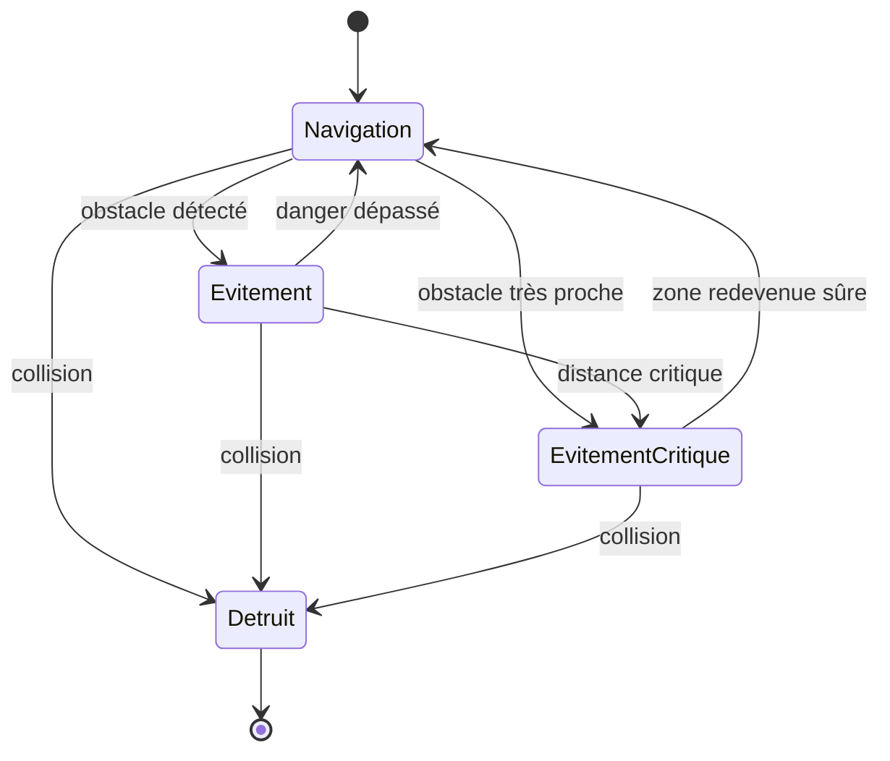
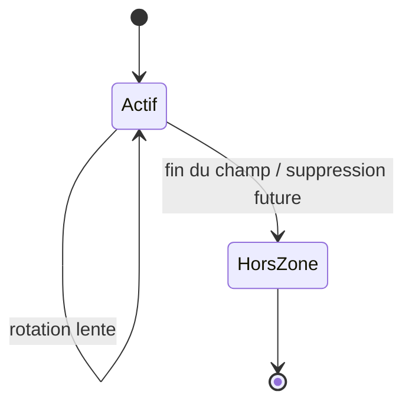
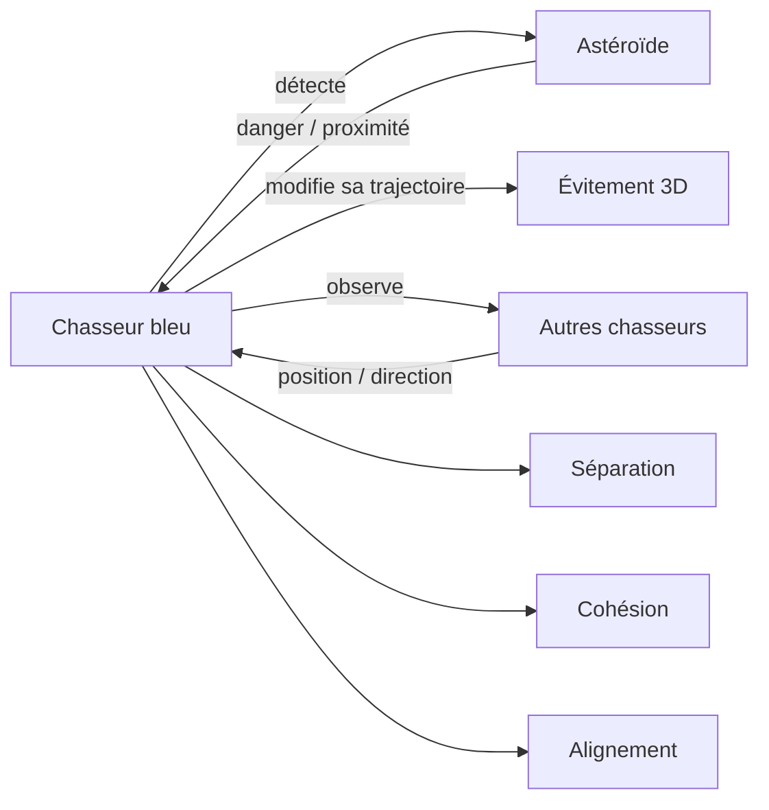

# Rapport — Simulation multi-agents spatiale sous Godot

## 1. Objectif du projet

Le projet consiste à réaliser sous **Godot 4.7.2** une simulation 3D de systèmes multi-agents dans un environnement spatial.

L'objectif est d'observer comment plusieurs agents autonomes se déplacent, perçoivent leur environnement, évitent des dangers et conservent un comportement collectif. Le projet est développé progressivement : chaque milestone ajoute une difficulté ou un nouveau type d'agent sans rendre le modèle inutilement complexe.

À terme, la simulation devra comporter au moins **4 types d'agents** et mettre en évidence au moins **un phénomène émergent**.

---

## 2. État actuel du projet

### Milestone 1 — Fondation

Le premier milestone a mis en place :

- 10 chasseurs bleus autonomes ;
- des astéroïdes de plusieurs tailles ;
- un environnement spatial 3D ;
- un mouvement autonome sur X, Y et Z ;
- séparation, cohésion et alignement entre chasseurs ;
- détection et évitement des obstacles ;
- collision réelle avec destruction du chasseur ;
- compteur de vaisseaux vivants et de morts.

### Milestone 2 — Mouvement, espacement, graphismes et caméra

Le deuxième milestone a amélioré :

- le mouvement relatif avant/arrière des chasseurs ;
- l'espacement entre les chasseurs ;
- l'anticipation des obstacles ;
- la prise en compte de plusieurs menaces proches ;
- les hitboxes ;
- le modèle visuel des chasseurs ;
- la variété et la rotation des astéroïdes ;
- le décor spatial ;
- une caméra de suivi et une caméra libre orbitale.

Validation du scénario normal avec la seed `20261012` :

- **10 survivants sur 10 après 90 secondes** ;
- distance moyenne au voisin le plus proche : **11,41 m** ;
- rapprochement minimal ponctuel : **5,52 m**.

Ces résultats indiquent que la survie est actuellement le comportement normal, tout en conservant la possibilité d'une collision réelle dans une situation difficile.

---

## 3. Types d'agents actuels

### Agent 1 — Chasseur bleu

Le chasseur est l'agent principal.

Il peut :

- avancer dans l'espace ;
- monter et descendre ;
- se déplacer vers la gauche ou la droite ;
- accélérer ou ralentir légèrement par rapport au groupe ;
- détecter ses voisins ;
- détecter les obstacles ;
- modifier sa trajectoire pour éviter une collision.

Son déplacement est obtenu par la combinaison de règles locales simples :

- **wander 3D** : mouvement autonome naturel ;
- **séparation** : conserver une distance avec les autres chasseurs ;
- **cohésion** : rester dans la même zone générale que le groupe ;
- **alignement** : suivre approximativement la direction des voisins ;
- **évitement** : contourner les obstacles détectés.

Aucune formation géométrique précise n'est imposée.

### Agent 2 — Astéroïde / obstacle spatial

Les astéroïdes forment actuellement la deuxième catégorie d'entités du modèle.

Ils existent en plusieurs tailles et formes, tournent lentement et constituent les principaux dangers à éviter.

Leur comportement sera enrichi progressivement afin que certains obstacles puissent devenir mobiles ou plus complexes.

---

## 4. Diagramme d'état — Agent 1

Le diagramme suivant représente le comportement général d'un chasseur sans détailler le code.

Pendant les états Navigation et Évitement, les règles de séparation, cohésion, alignement et wander continuent d'influencer le mouvement.

---

## 5. Diagramme simple — Agent 2

Dans la version actuelle, l'astéroïde possède surtout un comportement environnemental simple.

Ce comportement sera enrichi dans un milestone ultérieur pour certains types d'obstacles mobiles.

---

## 6. Interaction principale entre les agents

---

## 7. Paramètres importants

Le rapport final ne cherchera pas à détailler tout le code. Les paramètres principaux à étudier sont :

- rayon de perception des voisins ;
- distance de séparation ;
- force de séparation ;
- force de cohésion ;
- force d'alignement ;
- rayon de détection des obstacles ;
- force d'évitement ;
- vitesse moyenne des chasseurs.

Leur influence sera étudiée avec quelques configurations simples plutôt qu'avec une analyse exhaustive.

---

## 8. Caméra et observation

Deux modes de caméra sont disponibles :

- **Suivi** : la caméra suit automatiquement le groupe ;
- **Libre** : la caméra peut être déplacée autour de la simulation.

Commandes principales :

- **F** : alterner Suivi / Libre ;
- clic droit + souris : orbite ;
- molette : zoom ;
- flèches ou touches de déplacement : translation ;
- PageUp / PageDown : déplacement vertical ;
- **G** ou **Home** : recentrer la caméra sur le groupe.

La caméra est uniquement un outil d'observation et n'influence pas les agents.

---

## 9. Phénomène émergent étudié

Le phénomène émergent retenu est le **maintien et la reformation spontanée du groupe**.

Aucune position fixe n'est attribuée aux chasseurs. Chaque agent applique seulement des règles locales. Malgré cela, les chasseurs ont tendance à rester dans une même zone, à se séparer lorsqu'ils sont trop proches, à contourner les obstacles puis à retrouver le groupe.

Le phénomène sera étudié plus précisément dans les prochains milestones avec différentes difficultés et différents états initiaux.

---

## 10. Limites actuelles

La version actuelle comporte plusieurs simplifications :

- champ spatial fini ;
- évitement local sans planification complète de trajectoire ;
- hitboxes simplifiées ;
- obstacles encore principalement statiques ;
- seulement deux catégories d'agents pour le moment ;
- aucune arme ;
- aucun adversaire actif.

Ces limites sont volontaires afin de conserver un modèle simple et compréhensible.

---

## 11. Planning prévisionnel

### M1 — Fondation ✅
Chasseurs, astéroïdes, espace 3D, comportements de base, collision et HUD.

### M2 — Mouvement, espacement, graphismes et caméra ✅
Mouvement 3D plus naturel, meilleure séparation, évitement renforcé, environnement visuel et caméra libre.

### M3 — Variété des obstacles et difficulté progressive
Créer plusieurs familles de dangers et plusieurs configurations de difficulté, tout en gardant les chasseurs comme agents principaux.

### M4 — Agent 3 : danger mobile
Ajouter un nouveau type d'agent mobile capable de traverser ou perturber le groupe.

### M5 — Agent 4 : agent hostile / perturbateur
Ajouter un quatrième type d'agent avec un comportement clairement différent.

### M6 — Événements déclenchés et scénarios
Ajouter des touches permettant de provoquer volontairement certains dangers pendant la démonstration.

### M7 — Étude expérimentale
Comparer plusieurs valeurs de paramètres, plusieurs états initiaux et différents niveaux de difficulté. Mesurer les survivants, les morts et la dispersion.

### M8 — Armes des chasseurs
Dans les niveaux les plus difficiles seulement :
- tir frontal ;
- détection de cible ;
- bombes limitées avec zone d'effet plus importante.

### M9 — Finalisation
Stabilisation, vidéo de démonstration, rapport final, diagrammes et PowerPoint de 10 minutes.

---

## 12. Questions auxquelles le rapport final devra répondre

Le rapport final devra rester simple et répondre notamment à :

- Quels sont les agents ?
- Que perçoivent-ils ?
- Quelles actions peuvent-ils réaliser ?
- Quels sont leurs comportements ?
- Quel est l'état initial ?
- Quels paramètres sont importants ?
- Comment ces paramètres influencent-ils la simulation ?
- Quel phénomène émergent apparaît ?
- Le modèle est-il robuste aux variations d'états initiaux ?
- Comment la simulation se termine-t-elle ?
- Quels patterns spatiaux ou temporels apparaissent ?
- Quelles sont les limites du modèle ?
- Quelles améliorations seraient possibles ?

Ce document sera mis à jour à chaque milestone.
