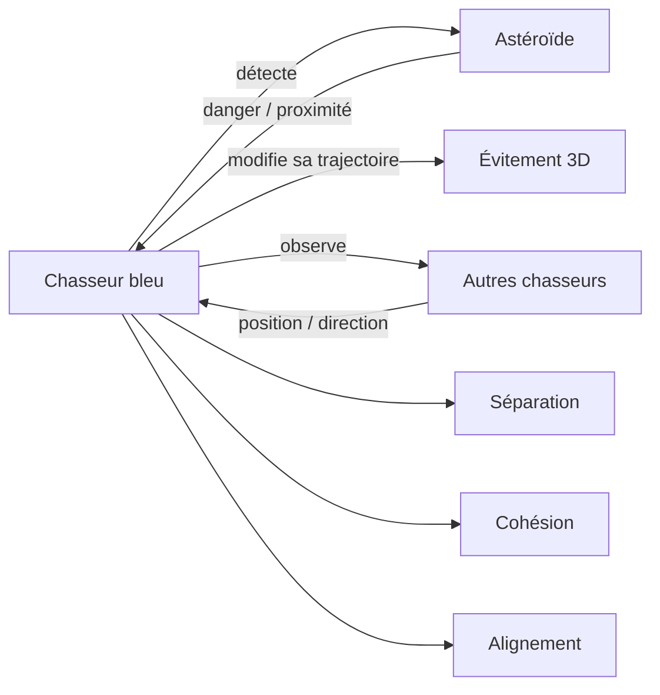
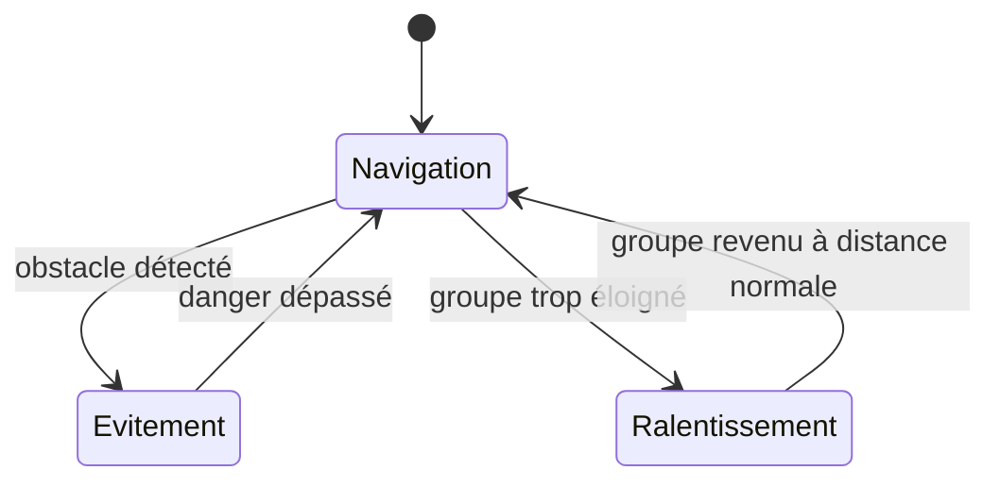
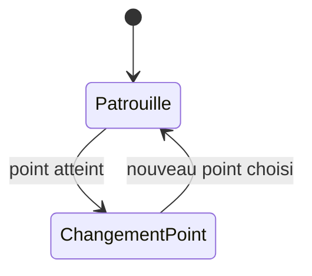
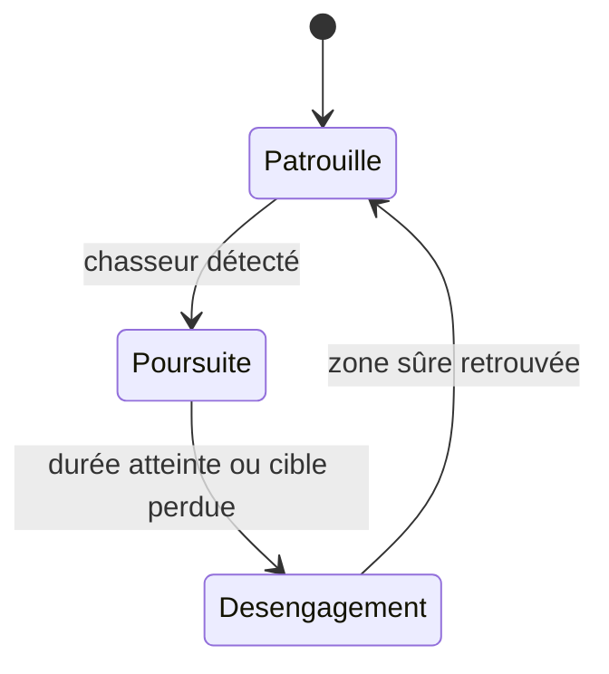

# Rapport — Simulation multi-agents spatiale sous Godot

## 1. Objectif du projet

Le projet consiste à réaliser sous **Godot 4.7.2** une simulation 3D de systèmes multi-agents dans un environnement spatial.

L'objectif est d'observer comment plusieurs agents autonomes se déplacent, perçoivent leur environnement, évitent des dangers et réagissent à d'autres agents. Le projet est développé progressivement afin de conserver un modèle simple, compréhensible et facile à présenter.

À terme, la simulation devra comporter au moins **4 types d'agents** et mettre en évidence au moins **un phénomène émergent**.

---

## 2. État actuel du projet

### Milestone 1 — Fondation

Le premier milestone a mis en place :

- 10 chasseurs bleus autonomes ;
- des astéroïdes de plusieurs tailles ;
- un environnement spatial 3D ;
- un mouvement autonome sur X, Y et Z ;
- séparation, cohésion et alignement entre chasseurs ;
- détection et évitement des obstacles ;
- collision réelle avec destruction du chasseur ;
- compteur de vaisseaux vivants et de morts.

### Milestone 2 — Mouvement, espacement, graphismes et caméra

Le deuxième milestone a amélioré :

- le mouvement relatif avant/arrière des chasseurs ;
- l'espacement entre les chasseurs ;
- l'anticipation des obstacles ;
- la prise en compte de plusieurs menaces proches ;
- les hitboxes ;
- le modèle visuel des chasseurs ;
- la variété et la rotation des astéroïdes ;
- le décor spatial ;
- une caméra de suivi et une caméra libre orbitale.

Validation du scénario normal avec la seed `20261012` :

- **10 survivants sur 10 après 90 secondes** ;
- distance moyenne au voisin le plus proche : **11,41 m** ;
- rapprochement minimal ponctuel : **5,52 m**.

La survie est donc actuellement le comportement normal, tout en conservant la possibilité d'une collision réelle dans une situation difficile.

---

## 3. Agents et environnement actuels

### Agent 1 — Chasseur bleu

Le chasseur bleu est pour le moment **le seul véritable type d'agent** de la simulation.

Il peut :

- avancer dans l'espace ;
- monter et descendre ;
- se déplacer vers la gauche ou la droite ;
- accélérer ou ralentir légèrement par rapport au groupe ;
- détecter ses voisins ;
- détecter les obstacles ;
- modifier sa trajectoire pour éviter une collision.

Son déplacement est obtenu par la combinaison de règles locales simples :

- **wander 3D** : mouvement autonome naturel ;
- **séparation** : conserver une distance avec les autres chasseurs ;
- **cohésion** : rester dans la même zone générale que le groupe ;
- **alignement** : suivre approximativement la direction des voisins ;
- **évitement** : contourner les obstacles détectés.

Aucune formation géométrique précise n'est imposée.

### Obstacles de l'environnement — Astéroïdes

Les astéroïdes ne sont **pas considérés comme des agents** dans le modèle actuel.

Ils constituent des éléments de l'environnement que les chasseurs doivent percevoir et éviter. Ils existent en plusieurs tailles et formes et tournent lentement.

De futurs types d'agents mobiles viendront perturber activement le groupe.

---

## 4. Diagramme d'état — Agent 1

Le diagramme suivant représente le comportement général d'un chasseur sans détailler le code.

Pendant la navigation et l'évitement, les règles de séparation, cohésion, alignement et wander continuent d'influencer le mouvement.

---

## 5. Interaction actuelle entre l'agent et son environnement

---

## 6. Paramètres importants

Le rapport final ne cherchera pas à détailler tout le code. Les paramètres principaux à étudier sont :

- rayon de perception des voisins ;
- distance de séparation ;
- force de séparation ;
- force de cohésion ;
- force d'alignement ;
- rayon de détection des obstacles ;
- force d'évitement ;
- vitesse moyenne des chasseurs.

Leur influence sera étudiée avec quelques configurations simples.

---

## 7. Caméra et observation

Deux modes de caméra sont disponibles :

- **Suivi** : la caméra suit automatiquement le groupe ;
- **Libre** : la caméra peut être déplacée autour de la simulation.

Commandes principales :

- **F** : alterner Suivi / Libre ;
- clic droit + souris : orbite ;
- molette : zoom ;
- flèches ou touches de déplacement : translation ;
- PageUp / PageDown : déplacement vertical ;
- **G** ou **Home** : recentrer la caméra sur le groupe.

La caméra sert uniquement à observer la simulation et n'influence pas les agents.

---

## 8. Phénomène émergent étudié

Le phénomène émergent principal est le **maintien et la reformation spontanée du groupe**.

Aucune position fixe n'est attribuée aux chasseurs. Chaque agent applique seulement des règles locales. Malgré cela, les chasseurs ont tendance à rester dans une même zone, à se séparer lorsqu'ils sont trop proches, à contourner les obstacles puis à retrouver le groupe.

Ce phénomène sera étudié plus précisément lorsque de nouveaux agents perturbateurs seront introduits.

---

## 9. Futurs types d'agents envisagés

Les astéroïdes resteront des obstacles de l'environnement. Le projet vise désormais quatre types d'agents simples à distinguer et à expliquer.

### Agent 2 — Leader jaune

Le leader sert de guide mobile au groupe sans imposer de formation fixe. Il se déplace dans l'espace, évite les obstacles et fournit une référence générale aux chasseurs.

Les chasseurs ne doivent pas se coller au leader : l'attraction vers lui ne devient importante que lorsqu'ils s'en éloignent trop. Dans une zone de confort, ils conservent surtout leurs règles locales de séparation, cohésion, alignement et wander.

Comportement prévu :

Le leader permet d'obtenir un essaim plus cohérent sans programmer une formation géométrique précise.

### Agent 3 — Drone de patrouille

Agent mobile simple qui suit plusieurs points de passage en 3D et peut traverser la trajectoire des chasseurs.

Comportement prévu :

Il crée une perturbation mobile prévisible sans poursuivre directement les chasseurs.

### Agent 4 — Intercepteur hostile

Agent réactif qui patrouille, détecte un chasseur proche, le poursuit pendant un temps limité puis se désengage.

Comportement prévu :

Cet agent introduira une perturbation directement liée au comportement des chasseurs.

Un poseur de mines reste une extension possible après ces quatre types d'agents.

---

## 10. Limites actuelles

La version actuelle comporte plusieurs simplifications :

- champ spatial fini ;
- évitement local sans planification complète de trajectoire ;
- hitboxes simplifiées ;
- obstacles principalement statiques ;
- un seul type d'agent pour le moment ;
- aucune arme ;
- aucun adversaire actif.

Ces limites sont volontaires afin de construire la simulation progressivement.

---

## 11. Planning prévisionnel

### M1 — Fondation ✅
Chasseurs, astéroïdes, espace 3D, comportements de base, collision et HUD.

### M2 — Mouvement, espacement, graphismes et caméra ✅
Mouvement 3D plus naturel, meilleure séparation, évitement renforcé, environnement visuel et caméra libre.

### M3 — Agent 2 : leader jaune
Ajouter un leader autonome servant de référence au groupe. Les chasseurs restent proches si la situation le permet, tout en conservant un espacement confortable et sans formation imposée.

### M4 — Obstacles et difficulté progressive
Enrichir les configurations d'obstacles et créer plusieurs niveaux de difficulté.

### M5 — Agent 3 : drone de patrouille
Ajouter un agent mobile simple suivant des points de passage et perturbant le groupe par sa trajectoire.

### M6 — Agent 4 : intercepteur hostile
Ajouter un agent capable de détecter puis poursuivre temporairement un chasseur.

### M7 — Événements interactifs et scénarios
Ajouter des touches permettant de déclencher volontairement des vagues d'obstacles ou l'arrivée de certains agents pendant la démonstration.

### M8 — Étude expérimentale
Comparer plusieurs paramètres, états initiaux et niveaux de difficulté. Mesurer notamment les survivants, les morts, l'espacement, la distance au leader et la dispersion.

### M9 — Armes des chasseurs
Dans les niveaux avancés seulement :
- tir frontal ;
- détection de cible ;
- bombes limitées avec zone d'effet plus importante.

### M10 — Finalisation
Stabilisation, vidéo de démonstration, rapport final, diagrammes et PowerPoint de 10 minutes.

---

## 12. Questions auxquelles le rapport final devra répondre

Le rapport final devra rester simple et répondre notamment à :

- Quels sont les agents ?
- Que perçoivent-ils ?
- Quelles actions peuvent-ils réaliser ?
- Quels sont leurs comportements ?
- Quel est l'état initial ?
- Quels paramètres sont importants ?
- Comment ces paramètres influencent-ils la simulation ?
- Quel phénomène émergent apparaît ?
- Le modèle est-il robuste aux variations d'états initiaux ?
- Comment la simulation se termine-t-elle ?
- Quels patterns spatiaux ou temporels apparaissent ?
- Quelles sont les limites du modèle ?
- Quelles améliorations seraient possibles ?

Ce document sera mis à jour à chaque milestone.
