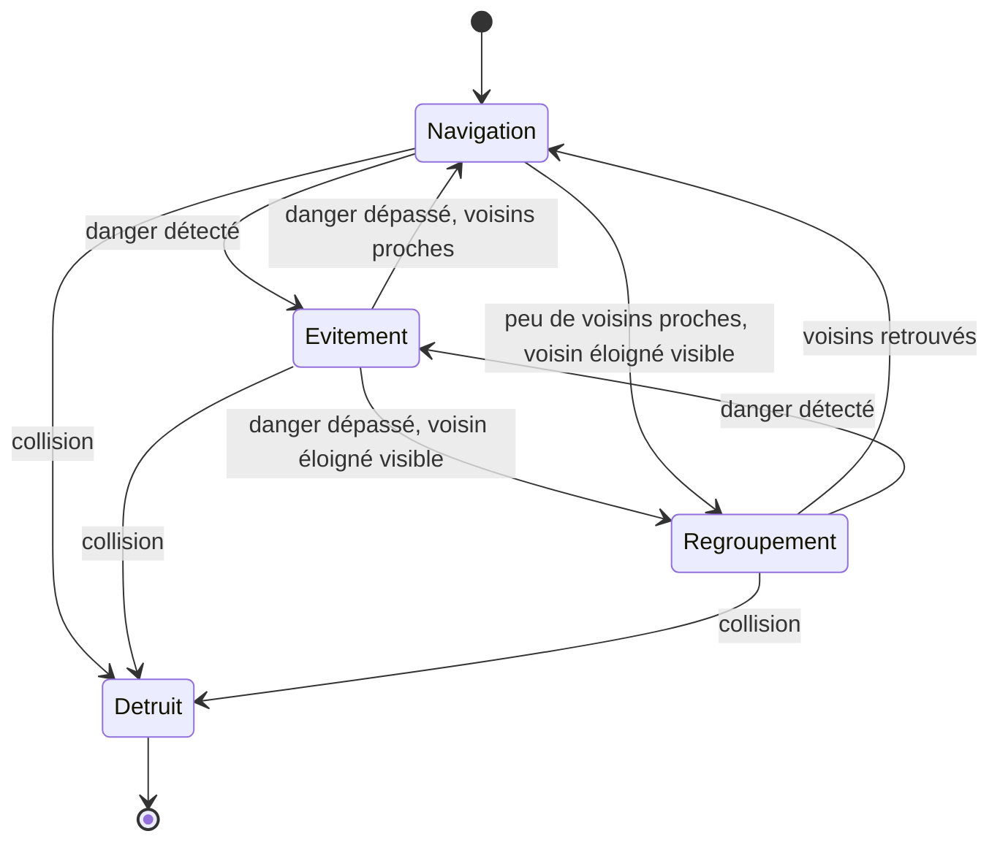
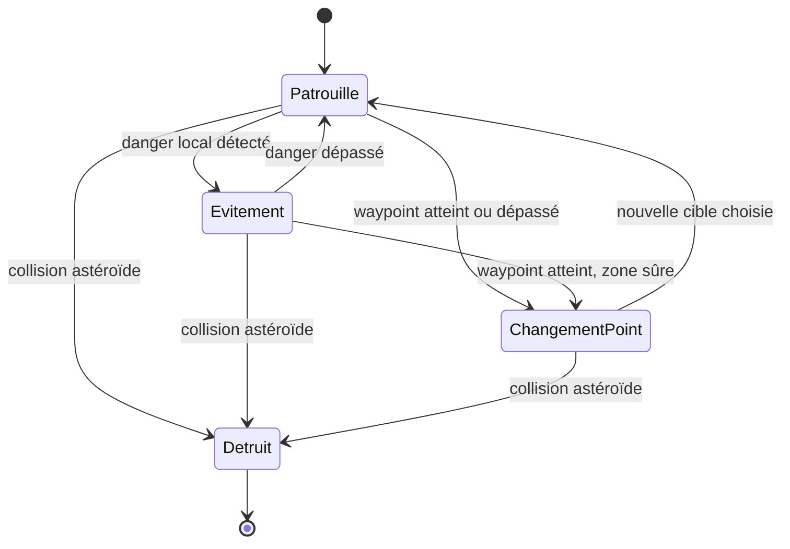
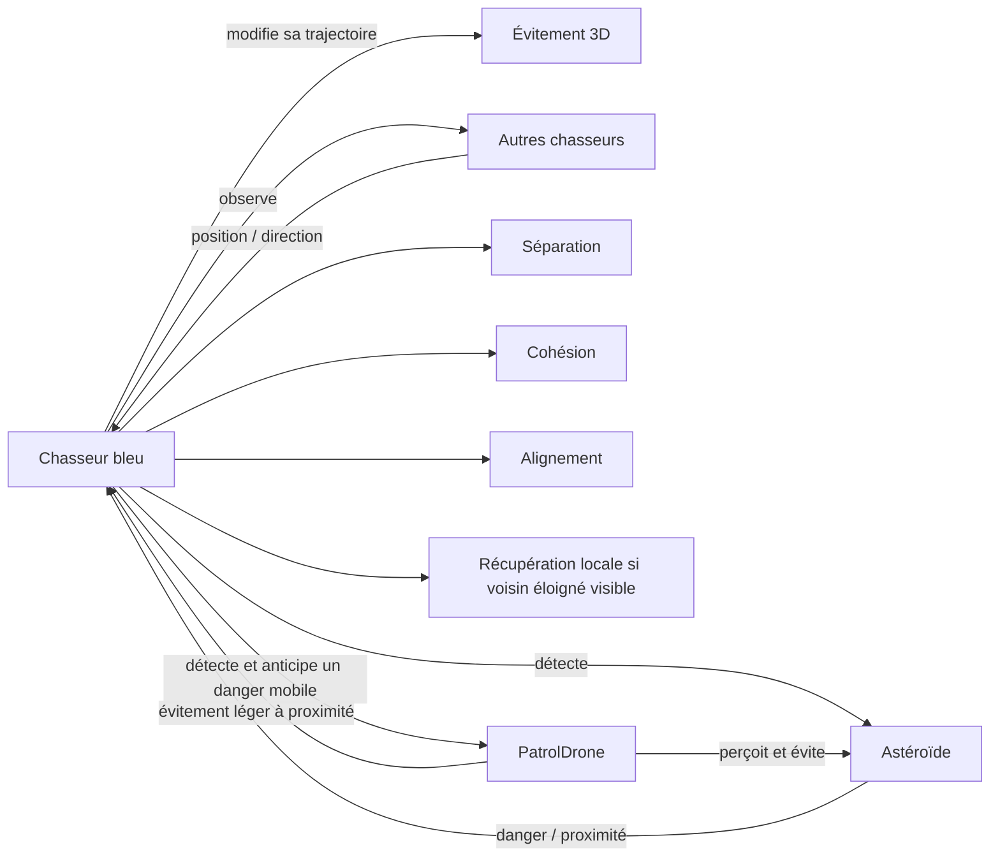
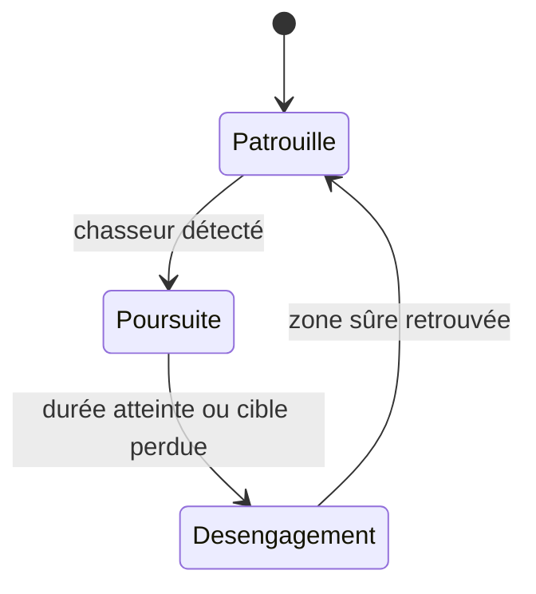
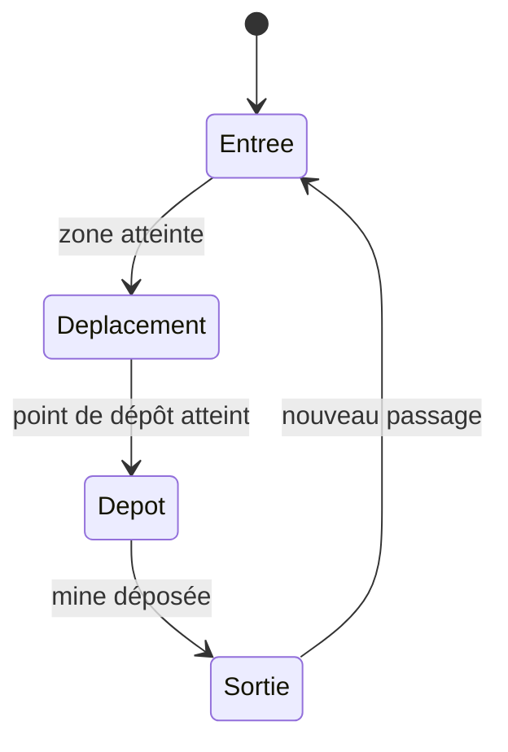

# Rapport — Simulation multi-agents spatiale sous Godot

## 1. Objectif du projet

Le projet consiste à réaliser sous **Godot 4.7.2** une simulation 3D de systèmes multi-agents dans un environnement spatial.

L'objectif est d'observer comment plusieurs agents autonomes se déplacent, perçoivent leur environnement, évitent des dangers et réagissent à d'autres agents. Le projet est développé progressivement afin de conserver un modèle simple, compréhensible et facile à présenter.

À terme, la simulation devra comporter au moins **4 types d'agents** et mettre en évidence au moins **un phénomène émergent**.

---

## 2. État actuel du projet

### Milestone 1 — Fondation

Le premier milestone a mis en place :

- 10 chasseurs bleus autonomes ;
- des astéroïdes de plusieurs tailles ;
- un environnement spatial 3D ;
- un mouvement autonome sur X, Y et Z ;
- séparation, cohésion et alignement entre chasseurs ;
- détection et évitement des obstacles ;
- collision réelle avec destruction du chasseur ;
- compteur de vaisseaux vivants et de morts.

### Milestone 2 — Mouvement, espacement, graphismes et caméra

Le deuxième milestone a amélioré :

- le mouvement relatif avant/arrière des chasseurs ;
- l'espacement entre les chasseurs ;
- l'anticipation des obstacles ;
- la prise en compte de plusieurs menaces proches ;
- les hitboxes ;
- le modèle visuel des chasseurs ;
- la variété et la rotation des astéroïdes ;
- le décor spatial ;
- une caméra de suivi et une caméra libre orbitale.

Validation historique du M2 avec la seed `20261012` :

- **10 survivants sur 10 après 90 secondes** ;
- distance moyenne au voisin le plus proche : **11,41 m** ;
- rapprochement minimal ponctuel : **5,52 m**.

La survie est donc actuellement le comportement normal, tout en conservant la possibilité d'une collision réelle dans une situation difficile.

### Milestone 3 — Regroupement et champ continu

Le troisième milestone ajoute :

- un regroupement autonome sans leader ni place attribuée ;
- une récupération locale jusqu'à **50 m**, lorsqu'un chasseur a peu de voisins proches ;
- un champ d'astéroïdes renouvelé devant les chasseurs et nettoyé derrière tous les survivants ;
- six configurations : rocher isolé, paire décalée, paire horizontale, paire verticale, groupe décalé, gros rocher avec deux petits compagnons ;
- trois difficultés automatiques selon la distance : facile avant **500 m**, intermédiaire jusqu'à **1 100 m**, difficile ensuite ;
- l'affichage de la distance, de la difficulté, de l'espacement moyen et de la dispersion, actualisé toutes les **0,4 seconde**.

Les astéroïdes sont des **obstacles de l'environnement et non des agents**. À la fin de M3, BlueShip était le seul type d'agent implémenté. Les graphismes et les commandes de caméra du M2 sont conservés.

Validation M3 sous Godot 4.7.2, seed `20261012`, pas fixe de 1/60 seconde, sans warning ni erreur :

| Résultat | 90 secondes | 300 secondes |
|---|---:|---:|
| Survivants / morts | 10 / 0 | 10 / 0 |
| Distance parcourue | 949,02 m | 3 167,86 m |
| Difficulté finale | 2 | 3 |
| Astéroïdes actifs au maximum | 29 | 40 |
| Configurations créées / supprimées | 27 / 16 | 92 / 79 |

Sur les 90 premières secondes, la distance moyenne au voisin le plus proche vaut **11,04 m**, le rapprochement minimal **6,71 m** et la dispersion maximale **23,96 m**. Aucun chasseur isolé au-delà du rayon normal de 32 m n'est observé. Les agents continuent d'avancer et le champ se renouvelle.

Après cinq minutes, il reste **29 astéroïdes actifs**, sous le plafond de **72**. Le nombre total de nœuds atteint au plus **620**. Le temps moyen de calcul par tick en mode headless reste proche de **0,48 ms** dans les deux fenêtres mesurées en difficulté 3. Cette mesure ne représente pas les FPS du rendu.

Les tests vérifient également les six configurations, leur reproduction avec la même graine, les seuils de difficulté, le nettoyage derrière un retardataire et l'absence de références invalides après suppression. Les tests de collisions réelles, de caméra et de mouvement du M2 restent valides.

---

### Milestone 4 — Drone de patrouille et difficulté au clavier

M4 ajoute le deuxième véritable agent, **PatrolDrone**, avec **deux drones verts** qui suivent leur propre route. Ils perçoivent leur waypoint, les astéroïdes locaux et les chasseurs très proches. Leurs décisions changent leur trajectoire ; ils ne poursuivent pas les BlueShip.

Les chasseurs anticipent désormais les croisements avec les drones à partir de leurs vitesses relatives. Les drones effectuent aussi un évitement léger à proximité d'un chasseur. Un contact réel reste possible : le BlueShip peut être détruit, tandis que le drone est considéré plus robuste. Un drone qui touche un astéroïde explose et Main le remplace après quelques secondes.

Les touches **0 / 1 / 2 / 3** permettent de reprendre le mode automatique ou de choisir facile, intermédiaire et difficile. Le changement concerne les nouvelles configurations d'astéroïdes ; celles déjà présentes restent en place. Le HUD indique **AUTO / MANUEL** et le nombre de drones actifs. Les statistiques et la caméra continuent à observer uniquement le groupe bleu.

Validation M4 sous Godot 4.7.2, seed `20261012`, pas fixe de 1/60 seconde, sans warning ni erreur :

| Résultat, 90 secondes | AUTO | MANUEL difficile dès le départ |
|---|---:|---:|
| BlueShip vivants / morts | 10 / 0 | 10 / 0 |
| Drones actifs / détruits | 2 / 0 | 2 / 0 |
| Distance parcourue | 948,98 m | 947,74 m |
| Difficulté finale | 2 | 3 |
| Astéroïdes actifs maximum | 29 | 38 |
| Ticks-agent de réaction à un drone | 432 | 231 |

Un tick-agent est un pas de simulation où un chasseur anticipe un danger mobile. Ce chiffre n'est pas un nombre certain de collisions évitées. En AUTO, l'espacement moyen vaut **10,96 m**, le rapprochement minimal **6,71 m**, la dispersion maximale **23,96 m**, sans chasseur isolé. En difficile manuel, l'espacement final vaut **11,26 m** et la dispersion finale **22,89 m**.

Le test de croisement contrôlé conserve le chasseur vivant, avec une distance minimale de **6,49 m**. Le stress avec perception désactivée confirme une destruction réelle. La patrouille est reproductible et change de waypoint. Les touches clavier, les états, l'évitement d'un astéroïde, la séparation entre flocking et danger mobile ainsi que les remplacements passent les tests. Les contrôles de caméra et le regroupement M3 restent valides.

Le test AUTO de **300 secondes** atteint **3 168,16 m**, niveau 3 : **9 chasseurs vivants, 1 mort, 2 drones actifs**. Aucun drone n'est détruit ; un est retiré loin derrière et remplacé. Le maximum observé est de **46 astéroïdes** et **688 nœuds**, avec un calcul moyen proche de **0,54 ms par tick headless**. La survie sur une longue durée n'est donc pas garantie. Le rendu et le drone vert en gros plan sont vérifiés visuellement.

## 3. Agents et environnement actuels

### Agent 1 — Chasseur bleu

Le chasseur bleu est **le premier des deux types d'agents** actuellement implémentés.

Il peut :

- avancer dans l'espace ;
- monter et descendre ;
- se déplacer vers la gauche ou la droite ;
- accélérer ou ralentir légèrement par rapport au groupe ;
- détecter ses voisins ;
- retrouver un voisin éloigné encore visible dans sa portée de récupération ;
- détecter les obstacles ;
- anticiper la trajectoire d'un drone proche ;
- modifier sa trajectoire pour éviter une collision.

Son déplacement est obtenu par la combinaison de règles locales simples :

- **wander 3D** : mouvement autonome naturel ;
- **séparation** : conserver une distance avec les autres chasseurs ;
- **cohésion** : rester dans la même zone générale que le groupe ;
- **alignement** : suivre approximativement la direction des voisins ;
- **évitement** : contourner les obstacles détectés ;
- **récupération locale** : revenir doucement vers un voisin visible entre 32 et 50 m quand moins de deux voisins sont proches.

Aucune formation géométrique précise n'est imposée.

### Agent 2 — Drone de patrouille

Le drone vert suit des points de passage 3D renouvelés au cours du vol. Son couloir est défini à son apparition, puis reste indépendant du centre des BlueShip.

Il perçoit :

- son waypoint courant ;
- les astéroïdes dans une portée de **44 m** ;
- les chasseurs à moins de **10 m**.

Il peut avancer, monter, descendre, changer de côté, ralentir légèrement, changer de waypoint et éviter un danger. Sa vitesse de base vaut **9,2 ou 9,8 m/s**, avec une petite variation. Une nouvelle cible se trouve **55 m plus loin**, avec des décalages X/Y autour du couloir.

Main vise **deux drones actifs**. Un drone détruit ou à plus de **120 m derrière tous les chasseurs** est remplacé après **5 secondes**, à **80–125 m devant le premier chasseur**, dans une position vérifiée sans rocher trop proche. Il peut y avoir momentanément moins de deux drones pendant le délai. Aucun drone n'est téléporté pendant sa patrouille et aucun ne choisit un chasseur à poursuivre.

### Obstacles de l'environnement — Astéroïdes

Les astéroïdes ne sont **pas considérés comme des agents** dans le modèle actuel.

Ils constituent des éléments de l'environnement que les chasseurs doivent percevoir et éviter. Ils existent en plusieurs tailles et formes et tournent lentement.

Le champ prépare des configurations jusqu'à 320 m devant le premier chasseur, autour de la position X/Y mesurée du groupe. Une configuration est retirée seulement lorsqu'elle est à plus de 100 m derrière le dernier survivant. La caméra et les chasseurs ne reçoivent aucune consigne de déplacement de ce système.

Le nettoyage protège aussi les drones encore actifs. Les futurs intercepteurs et poseurs de mines restent prévus pour les milestones suivants.

---

## 4. Diagramme d'état — Agent 1

Le diagramme suivant représente le comportement général d'un chasseur sans détailler le code.

Ces états décrivent la situation du chasseur. Les règles de séparation, cohésion, alignement, wander et récupération sont calculées continuellement. L'évitement prend la priorité en présence d'une menace. Aucun centre global ne sert de destination et aucun agent n'est téléporté.

---

### Diagramme d'état — Agent 2

Main peut ensuite faire apparaître un nouveau drone après le délai. Le drone décide selon ses perceptions locales ; le changement de waypoint n'est pas une route animée à l'avance.

## 5. Interaction actuelle entre les agents et leur environnement

---

## 6. Paramètres importants

Le rapport final ne cherchera pas à détailler tout le code. Les paramètres principaux à étudier sont :

- rayon de perception des voisins ;
- distance de séparation ;
- force de séparation ;
- force de cohésion ;
- force d'alignement ;
- rayon de détection des obstacles ;
- force d'évitement ;
- vitesse moyenne des chasseurs ;
- portée de récupération : **50 m**, contre **32 m** pour les voisins normaux ;
- seuil de récupération : moins de **2 voisins proches**, poids **0,8** ;
- espacement des configurations : **56 / 44 / 34 m** selon la difficulté ;
- seuils de progression : **500 / 1 100 m** ;
- horizon de génération : **320 m**, nettoyage : **100 m** derrière tous les survivants, plafond : **72 astéroïdes**.

La séparation douce commence à **11 m** et devient forte sous **7 m**. Ces valeurs validées en M2 sont conservées. La distance affichée vient de la progression en Z du centre mesuré des survivants. L'espacement affiché est la moyenne de leurs distances au voisin vivant le plus proche ; la dispersion est la plus grande distance au centre du groupe.

Pour le drone, les paramètres principaux sont la distance entre waypoints (**55 m**), leur portée d'arrivée (**7 m**), les écarts X/Y (**25 / 15 m**), la portée des astéroïdes (**44 m**) et la distance de sécurité envers les chasseurs (**10 m**). L'évitement léger du drone a un poids de **1,2** ; l'évitement mobile du BlueShip a un poids de **7** avec une anticipation de **3 secondes**.

Leur influence sera étudiée avec quelques configurations simples.

---

## 7. Caméra et observation

Deux modes de caméra sont disponibles :

- **Suivi** : la caméra suit automatiquement le groupe ;
- **Libre** : la caméra peut être déplacée autour de la simulation.

Commandes principales :

- **F** : alterner Suivi / Libre ;
- clic droit + souris : orbite ;
- molette : zoom ;
- flèches ou touches de déplacement : translation ;
- PageUp / PageDown : déplacement vertical ;
- **G** ou **Home** : recentrer la caméra sur le groupe.

La caméra sert uniquement à observer la simulation et n'influence pas les agents.

### Choix de difficulté

- **0** : AUTO, niveau selon la distance parcourue, avec les seuils de 500 et 1 100 m ;
- **1** : Facile manuel ;
- **2** : Intermédiaire manuel ;
- **3** : Difficile manuel.

Le HUD précise **AUTO** ou **MANUEL**. Un retour à AUTO à 800 m affiche le niveau 2. Les obstacles déjà présents restent en place ; le champ se renouvelle selon le mode choisi. Les deux drones restent observables dans tous les niveaux.

---

## 8. Phénomène émergent étudié

Le phénomène émergent principal est le **maintien et la reformation spontanée du groupe**.

Aucune position fixe n'est attribuée aux chasseurs. Chaque agent applique seulement des règles locales. Malgré cela, les chasseurs ont tendance à rester dans une même zone, à se séparer lorsqu'ils sont trop proches, à contourner les obstacles puis à retrouver le groupe.

M4 introduit une première perturbation mobile avec le drone de patrouille. Le phénomène sera étudié plus précisément avec les futurs agents perturbateurs.

Un test M3 commence avec dix chasseurs volontairement dispersés, dont certains n'ont aucun voisin dans les 32 m habituels mais voient encore un membre du groupe à moins de 50 m. En **30 secondes**, la dispersion diminue de **49,00 m à 19,92 m**. L'espacement final vaut **10,82 m**, avec un minimum observé de **7,15 m**. Ils retrouvent la même zone sans finir collés. À 70 m, un chasseur ne reçoit aucune attraction : la récupération reste locale et limitée.

---

## 9. Futurs types d'agents envisagés

Les astéroïdes resteront des obstacles de l'environnement. Le projet vise désormais quatre types d'agents simples à distinguer et à expliquer.

### Agent 3 — Intercepteur hostile

Agent réactif qui patrouille, détecte un chasseur proche, le poursuit pendant un temps limité puis se désengage.

Comportement prévu :

Cet agent introduira une perturbation directement liée au comportement des chasseurs.

### Agent 4 — Poseur de mines

Agent qui traverse une zone, choisit un point de dépôt, crée un danger statique puis quitte la zone ou recommence ailleurs.

Les mines créées seront des **obstacles de l'environnement**, pas des agents supplémentaires.

Comportement prévu :

Les deux futurs agents ajouteront la poursuite active et la modification de l'environnement. Le drone de patrouille, déjà implémenté, apporte la perturbation par trajectoire mobile.

---

## 10. Limites actuelles

La version actuelle comporte plusieurs simplifications :

- champ continu testé pendant cinq minutes, sans recalage de l'origine pour les parcours très longs ;
- évitement local sans planification complète de trajectoire ;
- récupération impossible si tous les membres de l'autre groupe sont au-delà de 50 m ;
- budget borné pouvant retarder la génération si le groupe s'étire exceptionnellement en profondeur ;
- hitboxes simplifiées ;
- obstacles principalement statiques ;
- deux types d'agents pour le moment ;
- anticipation mobile supposant une vitesse constante sur quelques secondes ;
- une mort réelle observée sur le parcours M4 de cinq minutes ;
- pas d'évitement entre drones et effectif temporairement réduit pendant un remplacement ;
- aucune arme ;
- aucun adversaire actif.

Ces limites sont volontaires afin de construire la simulation progressivement.

---

## 11. Planning prévisionnel

### M1 — Fondation ✅
Chasseurs, astéroïdes, espace 3D, comportements de base, collision et HUD.

### M2 — Mouvement, espacement, graphismes et caméra ✅
Mouvement 3D plus naturel, meilleure séparation, évitement renforcé, environnement visuel et caméra libre.

### M3 — Cohésion du groupe, obstacles et difficulté progressive ✅
Récupération locale, espacement conservé, champ continu borné, six configurations d'obstacles, trois difficultés automatiques et mesures du groupe. Tests de 90 et 300 secondes validés.

### M4 — Agent 2 : drone de patrouille ✅
Deux drones autonomes, waypoints renouvelés, perceptions locales, évitement réciproque, collisions et remplacement. Difficulté AUTO/MANUEL par 0/1/2/3, HUD et tests des deux modes sur 90 secondes.

### M5 — Agent 3 : intercepteur hostile
Ajouter un agent capable de détecter puis poursuivre temporairement un chasseur.

### M6 — Agent 4 : poseur de mines
Ajouter un agent capable de modifier l'environnement en déposant de nouveaux dangers.

### M7 — Événements interactifs et scénarios
Ajouter des touches permettant de déclencher volontairement des vagues d'obstacles ou l'arrivée de certains agents pendant la démonstration.

### M8 — Étude expérimentale
Comparer plusieurs paramètres, états initiaux et niveaux de difficulté. Mesurer notamment les survivants, les morts, l'espacement et la dispersion.

### M9 — Armes des chasseurs
Dans les niveaux avancés seulement :
- tir frontal ;
- détection de cible ;
- bombes limitées avec zone d'effet plus importante.

### M10 — Finalisation
Stabilisation, vidéo de démonstration, rapport final, diagrammes et PowerPoint de 10 minutes.

---

## 12. Questions auxquelles le rapport final devra répondre

Le rapport final devra rester simple et répondre notamment à :

- Quels sont les agents ?
- Que perçoivent-ils ?
- Quelles actions peuvent-ils réaliser ?
- Quels sont leurs comportements ?
- Quel est l'état initial ?
- Quels paramètres sont importants ?
- Comment ces paramètres influencent-ils la simulation ?
- Quel phénomène émergent apparaît ?
- Le modèle est-il robuste aux variations d'états initiaux ?
- Comment la simulation se termine-t-elle ?
- Quels patterns spatiaux ou temporels apparaissent ?
- Quelles sont les limites du modèle ?
- Quelles améliorations seraient possibles ?

Ce document sera mis à jour à chaque milestone.
